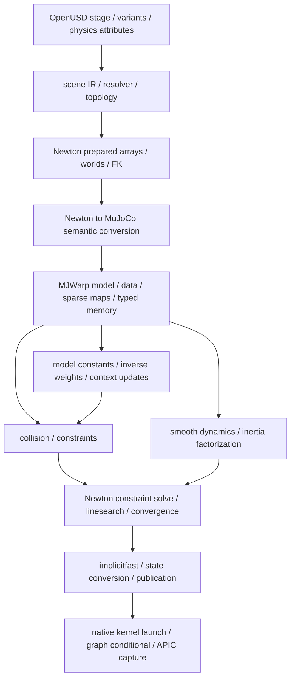

# APIC 物理程序的原生拆分

当前正在迁移的是固定 G1 配置的实际数组构造、宿主调度和选定物理 kernel。**完整 Newton/MuJoCo-Warp 物理闭包尚未迁完。** C ABI、NVRTC、conditional graph 和 APIC serializer 是可复用基础设施；它们需要与真实模型、kernel 及调度组合，才能生产完整四角色工件。

本文按真实 pin 源码拆分，不以“代码是 Python”判断是否可迁移。原 Python、旧 producer 和旧 launcher 继续保留。未执行测试、Python、SDK/GPU 初始化、模型/kernel 编译、APIC 导出或数值比较。

后续新增的 typed finalize、六类基本接触、packed-tree LDL、小块 Cholesky、动态线搜索/收敛和刚体参考常量，以及完整 set-constants 宿主顺序，见 [进一步迁移与边界](APIC_FINALIZE_SOLVER_MIGRATION.md)。这些端口尚未组成完整 Newton/原生 GPU 求解器。

模型 shape/contact 存储、复杂几何原生碰撞、混合分解与 GPU 多内核接入的下一层工作，见 [模型与 GPU 链路](APIC_MODEL_GPU_MIGRATION.md)。新端口沿用同一源码保全和不执行测试/SDK/GPU 的约束。

后续又增加原生 host Mesh/BVH cooking、有限 schema/equality、GPU GJK、真实 MathDx LTO 编译接口和设备收敛 WHILE，见 [进一步细分](APIC_COOKING_DEVICE_MIGRATION.md)。完整 USD/constraint/EPA/manifold/mixed GPU solver 仍保留明确缺口；主机版、CUDA 源生成和已验证设备执行分别记录。

## 固定来源与证据

IsaacLab 固定 `46d6cc3d7b115906fad12efd372fbf69f4e3d3ed`，Newton 固定 `71eeba16a717d4dcf0b9dd7056a7b6f863054dc3`，MuJoCo-Warp 使用官方 PyPI 3.15.0 sdist，Warp 固定 v1.17.0。分发包 SHA 为 `e87442ab4594d8132b7cf6e38b32aaa6130467b654bee260616e5817041e7045`。

[23 个子系统源码证据](APIC_PHYSICS_SOURCE_EVIDENCE.json)记录函数锚点、一基行号和全文件 SHA，并引用[上一层 22 文件证据](APIC_REMAINING_SOURCE_EVIDENCE.json)的字节 SHA。`scripts/audit_apic_physics_sources.mbtx` 只读取已暂存源码文本和哈希；不求值 Python AST，不把词法命中冒充实际运行闭包。

## 依赖图

任一节点只输出计划或原始属性时，都不能跳过下一层的数值/语义转换。CPU/Double 的 prepared arrays 和独立数值端口与上游 float32 CUDA 路径需要复测对齐。

## 1. Newton builder 与模型转换

| 子层 | 必须保留 | 当前可迁范围与缺口 |
| --- | --- | --- |
| USD 语义 | 实际 variant、单位/坐标系、body/joint local frames、schema resolver 顺序、enabled/collision 属性 | OpenUSD 原生读取已可产生真实 IR；原始 extension 属性不等于解析后的 Newton/PhysX/MJC 优先级 |
| 拓扑 | joint DFS、floating base、body 随 joint 顺序、parent/child 关系、canonical↔builder 映射 | MoonBit 可构造明确的拓扑、索引及默认 FK 数组；不能依据名称排序猜测 SDK 排序 |
| 刚体参数 | 显式 mass、COM、principal inertia frame；tensor rotation/inverse；无数据时的推断规则 | 显式参数可计算；缺失参数应保留未知并阻止“完整 model”声明，不能填单位惯量 |
| world/clone | 每 world body/joint/articulation 索引、初始位姿和刚性 clone offset | 可以生成 portable arrays；须保留 global world -1 与环境局部 world 的差异 |
| 最终构建 | shape cooking、mesh approximation、fixed-joint collapse、state/contact 扩展字段、finalize | 当前 prepared arrays 不等于完整 Newton `Model`/`finalize`；没有隐式 Python fallback 来假装完成 |
| 转 MuJoCo | 新建 MjSpec、solver option 优先级、actuator/geom/equality 及 per-world 映射 | 独立 source MJCF 的 `mjModel`/MJB 不能替代这次语义转换 |

对应入口为 Newton `ModelBuilder.add_usd/replicate/add_builder/finalize`、`parse_usd`、`SolverMuJoCo._convert_to_mjc`。核心证据：[builder](https://github.com/newton-physics/newton/blob/71eeba16a717d4dcf0b9dd7056a7b6f863054dc3/newton/_src/sim/builder.py#L4392)、[USD import](https://github.com/newton-physics/newton/blob/71eeba16a717d4dcf0b9dd7056a7b6f863054dc3/newton/_src/utils/import_usd.py#L131)。

## 2. Collision 与 sparse 程序

| 阶段 | 输入/输出与分支 | 原生迁移要求 |
| --- | --- | --- |
| broadphase | 过滤后的 geom pairs、body/weld IDs、margin/gap、AABB/radius、世界维度；输出 pair counter、pair/type 索引 | NXN 与 SAP 是不同程序；计数增长和容量截断须维持原规则 |
| narrowphase | 实际 geometry 类型；primitive、convex GJK/EPA、mesh/hfield/SDF/flex | 仅移植 NXN 候选生成不产生完整接触；未知 geometry 应拒绝，不能当作无碰撞 |
| constraint | equality/friction/limit/contact 分支、cone、Jacobian/force 和 sparse row/column 索引 | `njmax/njmax_nnz/nconmax` 与溢出标记是语义，不是可忽略的工作区大小 |
| inertia M | CSR 与每 tree dense/compact/block/LDL 混合布局、M 索引和 factor offsets | `is_sparse` 指 constraint Jacobian/Hessian 布局，不代表 M 可以简单切换为另一种矩阵 |
| solver force | done/state-changed/nefc/zero-force guards；CSR `Jᵀ*force` atomic accumulation | zero/rebuild 顺序、合法列映射、compact DOF -1 跳过和线程原子操作不能省略 |
| gradient/factor | `JTDAJ`、incremental Hessian、Cholesky、linesearch 与 Newton decrement | 一个 sparse MVM 或 `Jᵀf` 端口不等于完成求解器 |

MuJoCo-Warp `io.is_sparse` 在 AUTO 且 `nv>32` 时选择 sparse J/H；M 仍使用自身的 CSR/block 结构。broadphase 使用有效 pair 数与 geom 数决定 NXN/SAP。实际值必须由被构建的模型观察，不能预先宣称所有 G1 都走同一分支。源符号包括 `collision_driver._nxn_broadphase/_narrowphase`、`constraint.make_constraint/_efc_contact_jac_sparse`、`smooth.factor_m/_factor_blocks/_factor_i_sparse`、`solver._update_gradient`。

本轮选定的真实 kernel 范围包括 sparse MVM、对称 packed-M 到 MVM 索引构造、CSR constraint-force 重建，以及有明确 feature guard 的 NXN broadphase。它们仍缺完整 narrowphase、constraint generation、Hessian/factorization 和 integrator 闭包；实际可用集合以 `producer_native/physics_kernels` 的接口与工件 manifest 为准。

SAP 中的 scan/segmented sort 可直接连接 Warp C ABI，底层继续使用 CUB，不需把 CUB 改写为 MoonBit。新接口使用上传前逐值验证的不可变 host partition，要求首边界 0、末边界 count、单调且范围合法；不向调用者暴露可写 GPU pointer。APIC 直接登记同一份已验证的 host bytes，避免捕获内 D2H。任意 GPU producer 生成的动态边界暂未获得证明，当前应拒绝；固定 SAP 分区可由宿主真实构造。双 buffer、typed region 与生命周期仍须匹配。

## 3. Conditional loops 与宿主顺序

MuJoCo-Warp `solver._solve` 先 warmstart/init context/gradient，再产生 `nsolving` 条件，按 `graph_conditional` 选择真正的设备条件循环或固定最大迭代宿主循环，最后执行需要的 force 重建。`_solver_iteration` 内还包含 linesearch、constraint update、gradient 与 convergence。`iterations=100` 是上限，不能无条件执行 100 次不同语义的简化 kernel。

原生实现可以连接 Warp 的 graph insert-if/while、set-condition、pause/resume/check-body，并同步记录 APIC branch begin/end/conditional。条件缓冲区的 real int32 owner、parent graph/stream、分支中全部 kernel 的 APIC metadata 都必须匹配。条件体构造失败后，已修改的 parent graph 不应被当作可继续生产的成功状态；不支持驱动能力时应明确失败。

原生条件节点提供控制流能力，不自动提供 `_solver_iteration` 的物理程序。来源：[Warp conditional C ABI](https://github.com/NVIDIA/warp/blob/v1.17.0/warp/native/warp.h#L774)、[APIC branch ABI](https://github.com/NVIDIA/warp/blob/v1.17.0/warp/native/apic.h#L142)。

新增 physics-host 模式迁移固定 implicitfast/no-sleep/internal-contact 路径的 `SolverMuJoCo.step` 与 MJWarp forward/step 宿主顺序。真实 control/state 转换、collision、constraint solve、implicit integrator 和 FK 仍调用上游 SDK；该模式继续是显式 hybrid。它保留 device/determinism scope、RNE 请求、sensor/energy、callback、interval=1 同步及成功后 step counter 更新，不声称已把完整求解器改写成 MoonBit。

## 4. Context 与 set-constants

对固定 `SHAPE_PROPERTIES | BODY_INERTIAL_PROPERTIES`，需要实际更新质量/COM/主惯量、geom/site/pair 字段、invalidate contact cache，再重算常数、solref/tendon gains、恢复 connect anchors，最后同步 world-body geom/site 位姿。仅覆写模型 COM/friction base 没有完成 context 操作。

`set_const_fixed` 初始化 subtree mass 并按 body tree 反向累加。`set_const_0` 在 qpos0 计算 kinematics/COM/inertia/factorization、inverse weights、equality/camera/light/actuator 参考量，再恢复需要的状态。Newton 还额外区分物理惯量与 kinematic locking armature，保存/恢复 qpos，重算 physical mean-inertia。当前可移植各个明确公式与宿主次序，但不能把普通均值或局部 COM 改动标成完整 set-constants。

无 tendon/equality/sensor 的较窄端口可以明确要求实际计数为零；有相关输入时应拒绝或连接真实实现。`set_length_range` 不能随意加入运行期更新：上游有意保留编译期产生的 actuator length range。

本轮 `producer_native/constants` 是实际 CPU/Double 端口：body/geom/pair 参数、受限的对称主惯量分解、bottom-up subtree mass、已装配且带 authored armature 的 CSR M 对角均值，以及 qpos save/reference/restore 的 host 数据。它明确不提供 M 装配、factor/inverse weights、kinematic locking 处理或完整 `set_const_0`。Jacobi eigensolver 和串行累加次序与上游 float32 eig3/atomic_add 的数值对齐仍待复测。

## 当前完成度的可审查口径

| 层 | 可以声明的成果 | 仍不能声明 |
| --- | --- | --- |
| 基础设施 | 原生编译/launch/copy/scan/sort/conditional/APIC 接口及其显式输入契约 | 全部 physics kernel、有效设备执行或回放等价 |
| prepared builder | 真实 portable 数组、映射和受限的默认 FK/显式惯量计算 | 完整 Newton finalize、USD schema/cooking/推断等价 |
| 固定 kernel | 源 pin、typed specialization、具体算法与适用条件 | 通用 Warp AST compiler 或完整 G1 求解器 |
| physics host | 固定 profile 的真实宿主顺序，以及显式保留的 SDK backend | producer 完全无 Python |
| 数值与物理 | 尚待复测 | 静态检查不能证明 CPU/Double 与 float32 CUDA 学习结果等价 |

源码检查、接口生成、格式化和只读 SHA 审计继续进行；所有 numerical/runtime 验证都等机器空闲后执行。
