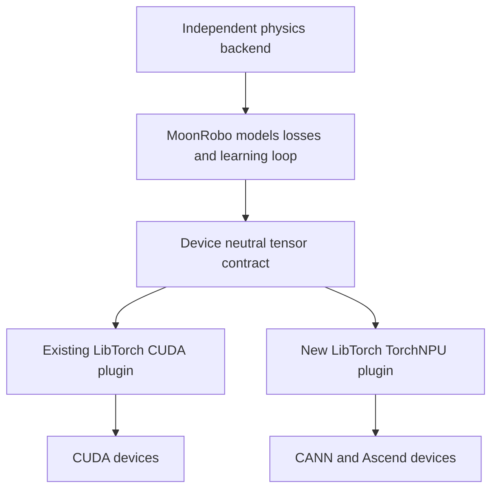

# Future Ascend backend alongside CUDA

Status: deferred alternative · 2026-11-17

This is a design proposal. Source paths below identify the original learning
workspace; this E1 archival series does not import that independent training
implementation. For measured 310P3 inference and hardware preparation, read
the [19 November findings](E1_COMMISSIONING_FINDINGS.md).

The selected E1 architecture is
[LunaKine actor deployment and LunaFlux LLM integration](LUNAKINE_DEPLOYMENT_PLAN.md):
MoonRobo retains LibTorch/CUDA training and E1 control; the separate `lunakine`
repository supplies Ascend actor inference; LunaFlux supplies LLM inference.
The Ascend training backend described below is deferred and is not a prerequisite
for LunaKine. Its LibTorch/TorchNPU inference alternative is not the selected
deployment route.

Add an Ascend NPU backend for MoonRobo training and actor inference alongside the
existing CUDA backend. Preserve the current MLP models and learning algorithm.
The proposed initial route retains the PyTorch tensor engine and adds an Ascend
C++ plugin using LibTorch, TorchNPU, and CANN. CUDA remains supported and serves
as a comparison backend. Ascend execution and training support require the
hardware and validation milestones below.

This work is independent of the
[LunaFlux training backend proposal](LUNAFLUX_TRAINING_BACKEND_PLAN.md), which
explores replacing LibTorch. Adding Ascend does not require that replacement or
a LunaFlux dependency.

## Current model and execution architecture

The aligned learner is MLP-based. In
[`networks.mbt`](../src/learning_aligned_gpu/networks.mbt), the default world
model has three hidden layers of width 2048 with SiLU and affine LayerNorm.
The actor has goal-encoder and history-decoder MLPs, and the critic is an MLP.
History inputs and imagined rollouts do not make these networks Transformers.
Attention, tokenization, and KV caching are not required by this learner.

MoonBit owns the algorithm in
[`learning_aligned_gpu`](../src/learning_aligned_gpu/README.md).
[`learning_tensor`](../src/learning_tensor/README.md) loads a C++ LibTorch
plugin through a C ABI. Generic tensor operations coexist with CUDA-specific
device selection, memory telemetry, collectives, custom kernels, graph capture,
and profiling. Backend portability therefore needs changes below the algorithm
layer and an audit of device assumptions in its callers.

## Proposed backend boundary

Introduce an explicit device kind and index, such as CPU, CUDA, or Ascend, plus
backend capability reporting. Replace assumptions that a nonnegative
`cuda_device` denotes every accelerator. Keep existing CUDA callers compatible
while adding the new contract. Select the tensor backend independently from
the physics backend, and report the selected implementation and precision.

Use separate plugin builds for CUDA and Ascend. Keep device discovery, allocation,
transfers, synchronization, telemetry, and collective implementation inside the
selected plugin. Version or extend the ABI as needed: the current required NCCL
symbol family must not force an Ascend plugin to load NVIDIA libraries.
Unsupported capabilities must fail explicitly when requested; there must be no
silent transfer to CPU or CUDA.

The first Ascend path should use ordinary supported tensor operations and
autograd. Add fused kernels or graph execution only after complete updates are
correct and profiling shows a benefit. Huawei supplies
[`libtorch_npu`](https://www.hiascend.com/document/detail/en/Pytorch/2610/installguide/swinstall/docs/en/installation_guide/building_libtorch_npu.md)
for C++ integration, but its documented example demonstrates inference. Treat
C++ backward, optimizer, and checkpoint execution for our workload as the first
feasibility gate, rather than assuming Python training support proves that path.

## Reuse and device specific work

| Component | Expected reuse and required work |
| --- | --- |
| Models and learning algorithm | High reuse of network definitions, losses, replay, dataset handling, normalization, and update ordering. Audit device-specific checks and configuration. No Transformer conversion is needed. |
| Generic ATen bridge | Reuse candidate for arithmetic, matmul, views, indexing, reductions, autograd, and Adam. Verify actual Ascend forward and backward coverage, layouts, dtypes, and serialization through the C++ bridge. |
| Tensor geometry | Reuse ordinary tensor expressions for SO(3), forward kinematics, observations, rewards, and termination. Check gradients and behavior near numerical boundaries. |
| Custom CUDA extensions | CUDA source and CUDA-specific compiled artifacts do not execute on Ascend. Initially select equivalent tensor expressions where available; otherwise implement an Ascend operator with a verified backward before enabling the feature. |
| Device services | Add Ascend device discovery, memory accounting, stream synchronization, profiling, and error handling. CUDA Graphs, NVTX, CUDA allocator queries, and TF32 controls remain backend-specific. |
| Distributed training | Implement gradient and statistics synchronization through Ascend collectives such as HCCL. NCCL wrappers cannot be reused directly. Defer this until single-device training passes. |
| Checkpoint state | Preserve logical parameter layout, Adam moments and steps, normalizers, RNG, replay, and counters. Validate host staging or an explicit conversion path; do not assume device-tagged archives load unchanged across backends. |
| Physics | Keep simulation selection separate. Begin with CPU MuJoCo collection and Ascend learning. The existing CUDA-based APIC/Warp path does not become Ascend-compatible through this tensor port. |

These are qualitative reuse estimates, not measured percentages. Shared source
does not establish equivalent numerical results, training stability, or speed.

## Lessons from vllm ascend and LunaFlux

Use vllm-ascend as a reference for backend registration, device capabilities,
memory layouts, synchronization, profiling, custom-operator integration, and
hardware-specific testing. Its
[documented stack](https://docs.vllm.ai/projects/ascend/en/main/getting_started/installation.html)
uses PyTorch and TorchNPU beneath the inference plugin. Pin a compatible
driver, CANN, PyTorch, TorchNPU, compiler, and host ABI combination for MoonRobo;
MoonRobo does not need to install vLLM to use those lower layers.

Direct reuse of its Transformer execution code is limited. Attention, KV caches,
token scheduling, quantized serving paths, and inference tensor parallelism do
not implement our training loop. RMSNorm cannot replace affine LayerNorm, and
SwiGLU cannot replace ordinary SiLU. Every imported custom operator would need
matching semantics and verified training derivatives. Local examples are
[`platform.py`](../../vllm-ascend/vllm_ascend/platform.py),
[`layernorm.py`](../../vllm-ascend/vllm_ascend/ops/layernorm.py), and
[`activation.py`](../../vllm-ascend/vllm_ascend/ops/activation.py).

LunaFlux offers useful patterns for checked layouts, explicit resource ownership,
execution planning, and capability selection. Its CUDA kernels and CUDA native
ABI cannot run on Ascend. Keep the Ascend effort focused on a second device
backend rather than making LunaFlux a prerequisite.

## Delivery milestones

| Milestone | Deliverable and exit criteria |
| --- | --- |
| 0 Hardware and C++ feasibility | Identify the exact Ascend card, memory, host architecture, and compatible software stack. Build a standalone C++ plugin probe that runs tensor creation, MLP forward, scalar backward, Adam, and save/reload on the NPU. Confirm device placement and exclude hidden CPU execution. Record supported precision and operator gaps. |
| 1 Portable backend contract | Add device selection and capabilities without changing CUDA defaults. Separate optional CUDA symbols and controls from required tensor operations. Existing CUDA behavior passes its focused regression checks; unsupported Ascend features fail before training starts. |
| 2 One world-model update | Match fixed weights and batches for forward values, loss, input and parameter gradients, clipping, Adam moments, step counters, and updated weights. Start with FP32 if supported by the selected card and stack; define any alternative precision policy explicitly. |
| 3 Complete single-device learner | Run multi-step world fitting, the actor imagined rollout, geometry, critic and GAE updates, and normalizer/replay integration using baseline tensor operations. Preserve frozen-network input gradients and microbatch semantics. |
| 4 Resume and evaluation | Save and restore complete learner state and compare the next update within the Ascend backend. Establish an explicit cross-backend checkpoint transfer path. Evaluate exported actors and sustained training across fixed seeds with CPU MuJoCo and matching assets. |
| 5 Optimization and distribution | Profile representative batches before adding Ascend fusion or graph execution. Validate backward for every optimized operator. Add HCCL synchronization and separately qualify distributed resume when needed. |
| 6 Supported second backend | Publish the supported card and software matrix, operation/precision coverage, checkpoint rules, measured budgets, and CUDA-versus-Ascend comparisons. Enable Ascend only for configurations that passed all applicable gates. |

During actor training, frozen world-model and critic weights still pass input
gradients back through the imagined trajectory to the actor. Forward-only
execution is insufficient. Validate the complete configured horizon, including
the existing 32-step path, and verify that earlier actions and actor parameters
receive gradients while frozen network weights remain unchanged.

## Acceptance and initial scope

Fix initial weights, data, sensor noise, permutations, and precision policy for
paired comparisons. Define per-operation and complete-update tolerances before
comparing results. Check geometry derivatives independently on small fixtures;
do not require cross-device bitwise identity from different reduction programs.
Test missing and nonfinite gradients, checkpoint failures, cleanup, memory
growth, and unsupported-feature rejection.

Measure synchronized tensor time, whole-iteration wall time, host transfers, and
peak host/device memory. Separate simulation collection from learner execution.
Keep batch sizes, algorithm, assets, and precision comparable, and report
hardware differences. Passing one update does not establish sustained training
quality or a performance advantage.

Initial scope is one Ascend device, the generic tensor path, CPU MuJoCo physics,
and the existing models. The exact card and stack remain open decisions.
Mixed precision, optimized geometry, graph capture, distributed execution, and
Ascend-native physics are later work, each requiring its own capability and
validation. If the native C++ training gate fails, resolve that gap or propose
an explicit alternative architecture before proceeding with the full backend.
