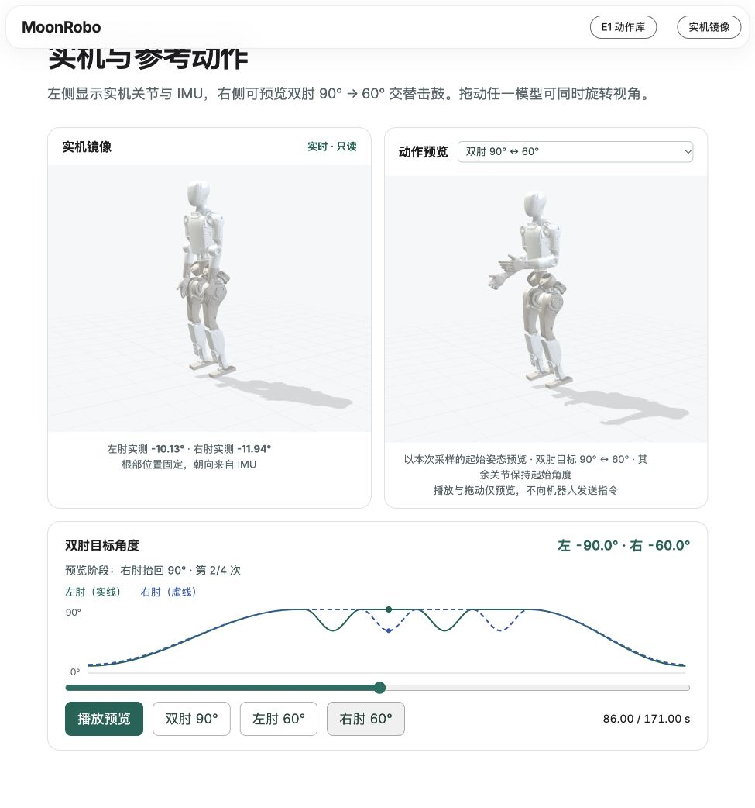

# E1 commissioning findings — 19 November 2026

The latest crane-supported powered retry completed the raised alternating
elbow sequence on Atlas `.191`. Its wire capture contains **83,745 full
24-record command frames**, two drops per elbow from −90° to −60°, and exact
return of the commanded targets. All 22 non-elbow command records stayed
unchanged. Measured stroke bends were **58.96–86.80° left** and
**59.44–86.67° right**. This establishes the recorded supervised elbow trial;
it does not establish physically motionless legs, balanced standing, physical
handback or autonomous actor-driven robot operation.

This record supersedes earlier session notes saying that mode 2 or real elbow
motion had not yet been tried. The dated plans retain their earlier evidence
for context. The [sanitized evidence manifest](evidence/e1-commissioning-20261119.json)
contains derived results and SHA-256 hashes for 15 saved runs. Raw PCAPs,
telemetry, binaries, model weights and credentials remain outside Git.

## Selected software architecture

| Component | Ownership and placement |
| --- | --- |
| MoonRobo training | LibTorch/ATen + CUDA, called through a native C ABI from MoonBit; world model, actor and critic training, autograd and optimizer state. |
| LunaFlux + MiniCPM | Separate DGX Spark `.179`; LLM inference and asynchronous perception/task proposals. Selected checkpoint: `openbmb/MiniCPM-V-4.7-35B-A3B`, revision `98e79ba972b586ac6146d3505771ce1467e199ba`. |
| LunaKine | Separate `lunakine` actor-runtime repository; frozen actor inference through CANN/AscendCL on the Atlas 300V host `.191`. |
| MoonRobo E1 runner | Local observations/history, reference progression, skill supervision, action conversion, SDK transport and E1 control on `.191`. It does not wait for LLM token generation at each control tick. |

The current actor is an MLP, not a Transformer. Its inference needs dense
layers, activations, normalization, fixed-shape buffers and a verified action
mapping. LunaFlux's attention, tokenizer, KV cache and LLM scheduler do not
implement this actor. Reusable ideas include resource ownership, explicit
completion, artifact/version contracts and bounded requests. CUDA kernels
cannot execute on Ascend unchanged. vLLM-Ascend can inform integration and
serving patterns; it is not a drop-in robot actor engine. No measured percentage
of reusable LunaFlux code was established.

Replacing LibTorch for training would additionally need differentiation,
backward kernels, optimizer execution/state, activation lifetimes, checkpoint
resume and numerical/performance qualification. That proposal and an Ascend
training backend are deferred. They are not prerequisites for the selected
inference split. See the [deployment plan](LUNAKINE_DEPLOYMENT_PLAN.md),
[implementation history](LUNAKINE_IMPLEMENTATION_PLAN.md),
[LunaFlux training alternative](LUNAFLUX_TRAINING_BACKEND_PLAN.md) and
[Ascend training alternative](ASCEND_BACKEND_PLAN.md).

## Hardware and host preparation

The earlier RTX 2080 proposal was replaced by the separate DGX Spark. Recorded
17 November inspection identified Spark's GB10, AArch64, Ubuntu 24.04.2,
driver 580.178.04 and CUDA compiler 13.0.88. The selected model's 16 shards and
nine native CUDA modules were prepared. Four native text requests matched
upstream greedy choices across 34 sampled steps including EOS; measured maximum
logit difference was 1.53125, so this is not numerical equivalence. Red/blue
image probes, subsequent text reuse, JSON/SSE serving and two-host task planning
to a recorded NPU shadow actor passed. Broader quality and sustained serving
remain separate work. Those checks did not drive the real E1.

Atlas 300V was identified as **Ascend 310P3**, PCI `19e5:d500`, health OK.
HDK 25.5.2 failed to build against the host kernel because of a `MIN` macro
redefinition; it was uninstalled. Driver 26.1.1, matching firmware 9.0.0.9.220
and CANN 9.1.0/310P operators were installed and verified after reboot on kernel
6.8.0-149. These are dated installation observations, not a claim that no later
administrator change occurred.

The actual FP32 actor passed 1,000 post-reboot NPU calls / 29,000 action
comparisons. Maximum absolute error against LibTorch was
`2.86102294921875e-6`; transfer-inclusive latency was 2.333 ms mean,
2.392 ms p99 and 2.445 ms maximum. The session closed and NPU resources returned
to idle. These sampled inference results do not qualify the complete physical
control loop or long-term scheduling behavior.

The host later failed during PCI initialization with the RTX 2080, Ascend and
FPGA installed: D2 resource-allocation errors and a B6 stall were reported.
The operator increased the BIOS MMIO aperture from 1 GB to 16 GB and reported
that all three cards then booted together. This supports a PCI resource-window
explanation; an OS driver conflict was not established. Above-4G decoding and
MMIO settings are firmware/platform settings, not extra VRAM. Firmware rollback
to 7.1.0.3.220 and VM passthrough were discussed; neither was established as the
successful fix. Keep this resolved BIOS configuration in the machine inventory.

Management uses `enp4s0` on `192.168.2.191`; E1 uses the other port, `eno1`.
The operator confirmed `.191` is the only development computer, so `eno1` was
persistently assigned `192.168.55.101/24`, without robot-side gateway/DNS.
The discovered E1 is `192.168.55.102`. Keep the two networks separate and bind
DDS to the robot interface. The working cluster gateway port was 32123, not
32122. No login secrets are part of the deployment source.

## SDK versions, decoding and shutdown

The purchase date `4/1/2026` is **4 January 2026**, using the Australian date
format. The 5 January and 29 January guides describe an older interface than
the supplied 3.1 SDK. The requested January `dds_demo_release_e1.tar.gz` was
not obtained; no missing archive was reconstructed or represented as official.
Saved discovery and wire captures, not the filename alone, establish compatibility.

The robot status contains **24 motor records, IDs 0–23**. There are 23 modeled
physical joints; slot 23 is reserved and its raw numeric value must not be
interpreted as a joint angle. Left elbow pitch is ID 3, right is ID 14; leg
IDs are 5–10 and 16–21. The supplied joint map is versioned in
[`deploy/e1/e1-joints.json`](../deploy/e1/e1-joints.json).

The legacy getter copied only records 0–20. The fixed adapter/raw decoder reads
all 24, retaining right-ankle, waist and reserved fields. The captured status
layout is 1,156 bytes in plain little-endian XCDR1. Its count is at byte 372;
the newer 3.1 variant has work mode there and count at 376. Both begin motor
records at byte 380. Schema selection uses the complete advertised DDS type ID,
not a scan for any integer equal to 24. The captured old schema does not report
firmware version, active command owner or active work mode.

The SDK shutdown crash came from its background activity outliving the DDS
writer during destruction. The wrapper retains callback state for process
lifetime; the low-control plugin runs the vendor singleton inside a supervised
Linux worker. Close, normal exit, blocked initialization, stalled input and
client death were exercised in loopback isolation. One installed explicit-close
test checked all 751 targets × 24 fields/records over 15 seconds, then observed
955 ms without another motor packet. A staged stalled-update run stopped
publication 98.46 ms after the final update with the configured 100 ms host
timeout. Discovery match disappearance took about ten seconds in that fixture.
These host observations do not establish the E1 firmware's missing-command
behavior. No unsupported vendor unsubscribe or firmware patch was introduced.

The maintained Python read-only receiver creates a DDS status subscriber
directly and avoids initializing the vendor command singleton. SDK wrapper,
worker and raw status reader remain separate from the January powered sender.

## Shoulder offsets and ankle telemetry

Fresh raw packets independently agreed with the decoder on all 24 positions,
velocities, torques, temperatures, IDs and errors. At the audited posture,
shoulder roll was −4.5134° left and +3.3550° right. The SDK guide lists
0–135° and −135–0°, while both supplied assembly URDFs allow approximately
−4.5837–130.0614° and −130.0614–4.5837°. The raw posture fits the assembly
ranges. Its CSV has blank calibration/soft-limit fields. URDF origin rotations
are geometry, not proof of this unit's encoder zeros. No unit-specific
commissioning record was supplied. Clamping those readings to zero would change
the requested pose; no such correction was applied.

The first 9.2157° left ankle-roll jump exists in raw received bytes. It reverses
one packet later, around 2.86 ms, implying roughly 3,220°/s while reported speed
remains around half a degree per second. Capture sequence/checksum checks did
not show corruption there. Later captures contain single-packet 1.263° pitch
steps and other posture-dependent combinations. Thus the 21-record copying bug
was real, but fixing it did **not** remove every ankle spike. Reporting artifacts
are strongly suggested by the immediate reversals and velocity mismatch; one
telemetry channel cannot prove that the hardware did not move.

The standing guard no longer relies only on a list of known spike amplitudes.
After healthy history, an abrupt ankle-only change inconsistent with velocity
is provisional. The immediately next consecutive packet must restore all four
ankles within 0.1° of their previous valid values, within 6 ms. A provisional
sample does not change the reference, target or last-valid status. A target tick
waits for confirmation. Sustained abrupt drift can therefore take one additional
packet to stop. Gradual over-limit drift, knee/other joint movement, velocity
corroboration, partial recovery, missing recovery, invalid data and sequence
problems still stop. `begin_hold()` preserves healthy history when capturing the
hold; resetting that history had caused the first post-transition spike to fail.

The original standing 1° stationary-joint criterion was our commissioning
setting, not a vendor specification. Once the operator explicitly selected
crane-supported operation, a separate suspended profile accepted measured
settling at non-elbow joints within SDK leg travel while preserving their
command records. This is a different acceptance condition, not evidence that
legs remained physically motionless. The latest raw report includes a maximum
17.27° ankle excursion including spikes; it must not be presented as either
verified real travel or verified zero motion.

## Why the first elbow commands did not move

The full actor's output is not an identity copy of the requested elbow reference.
It was trained for coupled whole-body behavior, emits normalized actions and
uses observation/history plus an action conversion. Even its zero-offset hold
prediction can differ from the measured posture and affect legs. A 0.1° input
therefore does not constrain output to 0.1° or isolate one joint. The observed
approximately −13° proposal and leg changes were shadow outputs, not evidence
of those physical motions. A deterministic elbow-only path was introduced for
commissioning; it copies the hold frame and changes only selected elbow positions.
The successful trials below use this path, not the learned NPU actor.

The first powered 5° trial sent 1,571 valid January-shaped frames, but requested
**DDS mode 1**. The 29 January guide specifies 1 = highmode, 2 = lowmode;
the 5 January guide says low control was not yet open. The C++ enum ordinal,
handheld Walk mode and DDS mode field are different concepts. The elbow stayed
at −1.89065° and the 1° following guard stopped after 3.242 seconds. A steady
hold plus a working handheld could occur while factory control retained authority.

The corrected sender uses the exact January types:

| Topic | Serialized DDS type ID |
| --- | --- |
| `Motor_Cmd_Topic` | `00070000f2f315417f2fd893ffc1e75f2c4f08` |
| `Control_Mode_Topic` | `00070000f2cc773776cccd5cf6f3ba76cf79c6` |

Motor payloads include embedded `controlcmd`, **action 11 and axes [0, 0]**,
all 24 motor records and timestamp. The newer vendor writer omits `controlcmd`
and has a different type ID, so restoring that writer would reintroduce the
known mismatch. January documents describe action 11 inconsistently across
interfaces; the newer enum uses another DEFAULT value. The implementation
preserves the exact tested combination, requests mode 2 once, and does not
infer a firmware-mode ACK from sent packets. The successful later measured
elbow motion establishes useful acceptance for that tested setup.

Robot source time was approximately **1,437.903 seconds ahead of host time**.
Payload microseconds and DDS nanoseconds are handled coherently without changing
either operating-system clock. Successful trials used host-domain timestamps.
A robot-domain timestamp probe stopped on freshness after 0.729 seconds, before
the stroke. Clock skew is real; its role in earlier failures was not proved,
and changing clocks is not the demonstrated fix.

## Pipeline and timing fixes

A standalone mirror subscription and a trial observer running together produced
duplicate RTPS DATA that tripped continuity checks. Use a single status observer
during a trial; the packet decoder can refresh the mirror itself. Optional
mirror writes were moved to a bounded background worker, and planner heartbeats
are emitted every 10 ms. The independent sender publishes at 2 ms and retains
40 ms freshness and 10 ms publication-lateness checks. The final pipeline runs
completed without changing gains. This does not prove one exclusive root cause
for every prior following-error stop.

Initial raised-arm shadow replay captured a real 15.6477 ms robot-source pause
with consecutive sequences and a matching arrival gap. Suspended cadence now
uses the existing 40 ms freshness budget; the separate standing spike-recovery
window remains 6 ms. Missing/duplicate sequences, reversed time, stale samples
and motor errors remain failures. Raised target ticks schedule 20–40 ms from
their actual prior tick, avoiding burst catch-up after a pause. Reference
progress can wait when advancement would violate the existing 5° following
check. The two powered raised runs recorded zero reference-wait ticks.

Candidate modeled-joint gains remain kp 50; kd is 1 on ankles 9, 10, 20, 21 and
5 elsewhere. Reserved slot 23 remains position 0, kp 0, kd 5. Velocity and
feedforward torque stay zero. No gain or torque-limit increase was used to
make an unresponsive elbow move.

## Powered trial progression

All rows below describe the archived 19 November trials. Durations include
lead-in/tail holds. A completed command sequence and measured displacement are
reported separately; stopped trials are retained rather than counted as passes.

| Evidence label | Active seconds / outbound frames | Outcome |
| --- | ---: | --- |
| `single-initial` | 4.500 / 2,174 | Accidental 1° following setting stopped; target offset −2.96°, measured −1.92°. |
| `single-restored` | 9.539 / 4,619 | Restored 5° following; stopped with target −16.75°, measured −11.72° offset. |
| `single-slow` | 24.957 / 12,043 | Slower reference still stopped on following; target −14.82°, measured −9.81° offset. |
| `robot-clock-probe` | 0.729 / 353 | Freshness stop during hold; no elbow trajectory. |
| `single-reset` | 14.715 / 7,106 | After handheld reset, freshness stop; target −5.02°, measured −3.32° offset. |
| `single-pipeline` | 181.498 / 87,368 | Full slow fold/return; −90° commanded offset; measured displacement 86.38°. |
| `single-repeat` | 181.496 / 87,497 | Full repeat; measured displacement 86.29°. |
| `drums-20deg` | 16.917 / 8,189 | Left stroke followed; right following error stopped the larger candidate. |
| `drums-10deg` | 49.500 / 23,859 | L–R–L–R completed; measured displacement 9.11° left / 9.22° right. |
| `drums-retry-stale` | 0.312 / 152 | Freshness stop during hold; no stroke. |
| `drums-10deg-repeat` | 49.500 / 23,886 | Completed; measured displacement 8.63° on each side. |
| `raised-powered` | 173.667 / 83,829 | Both −90° targets, two 30° drops each, exact target return; 2,011,896 motor records checked. |
| `raised-powered-repeat` | 173.958 / 83,745 | Same full sequence; 2,009,880 motor records checked. |

The latest raised run started at −11.3984° left / −13.1470° right. Three seconds
after disconnection, feedback was approximately −12.6443° / −13.8027°. Target
return was exact; measured return was not identical. During each stroke the
inactive elbow remained raised near 86.8° left or 86.7° right. These are measured
bends, not exact attainment of both nominal endpoints.

The raised reference has 8,551 samples and a nominal 171-second trajectory:
60 seconds raise, two seconds hold, four 16-second down/up strokes, 45 seconds
return. Each drop/lift takes eight seconds. Peak angular stroke speed is about
5.89°/s, compared with 2.62°/s for the earlier 10°/12-second cycle. Angular motion
is faster; beat frequency is not higher. Startup holds and actual scheduling
explain the longer observed duration. This timing is also shown by the website.

Before powered raised execution, `raised-shadow-fixed` completed all 8,551
frames using live non-elbow telemetry with explicitly simulated elbow tracking;
it created no command publisher. It validated the candidate and fixed target
records, not the robot's ability to track them.

## Live website and reproducibility

Host SDK/runtime installation, source changes, the static `eno1` address and
BIOS MMIO settings persist. A trajectory is a per-session reference; the
preserved commissioning path does not flash E1 firmware or write a taught
action slot. No automatic control startup service was installed. Session end
does not itself guarantee restoration of a physical pose or factory authority.

The [standalone live view](../ui/rabbita-cockpit/e1/README.md) shows measured
23-joint pose plus IMU on the left and a labeled reference on the right. The
root position is fixed; camera rotation is synchronized. Both elbow angles,
the 90° pose, individual 60° drops, playback and scrubbing are available. These
controls do not publish motor commands. A stale source stops refreshing the
private pose file; the local endpoint returns 503 after expiry.

This screenshot is a UI preview before the raised trial, not visual proof of
the complete physical sequence. The BSD-3-Clause Noetix geometry notice and
per-asset hashes are retained. Training datasets and checkpoints are excluded.

The clean-checkout validation for this archival change passed:

- 42 native tests across the selected SDK/motion/filter/replay packages
  (including the 40-test motion/low-control subset); optional vendor SDK ABI test explicitly
  skipped where proprietary dependencies were absent.
- Two SDK-free C++ decoder/guard tests via CMake/CTest on `.191`; the same tests
  passed Clang AddressSanitizer/UndefinedBehaviorSanitizer locally.
- Full isolated raised replay: 87,333 DDS frames / 2,095,992 motor records,
  both −90° targets, two 30° drops each, zero change to other targets and
  disconnected endpoints. This fixture ran about 181 seconds with simulated
  feedback; it is not another physical trial.
- Six loopback-only scenarios: hold, suspended settling, full 5° elbow,
  motor fault, stale input and independent sender watchdog. The watchdog
  fixture recorded about 35 ms active publication before expiry. Namespace
  checks require `lo` only, so these tests cannot reach the robot network.
- Four frontend checks covering all model hashes/geometry, reference poses,
  complete smooth preview and read-only endpoint/staleness behavior; standalone
  Vite production build. Vite reports the normal >500 kB Three.js bundle warning.
- Five pure transport-validation tests passed on `.191` without creating a
  DDS participant or opening the robot link.
- Scoped `moon info`, `moon fmt`, native controller build and standalone script
  checks. Existing async dependency deprecation/duplicate-import warnings remain.

The first back-to-back portable fixture run revealed that async 0.20.2's
recursive `mkdir` still failed on an existing `runs` directory. The harness
now checks for existence before creating it; the complete default suite passed
on the subsequent run. This changes test setup, not live control semantics.

Build/launch and archive-analysis instructions are in
[`deploy/e1/README.md`](../deploy/e1/README.md). The sanitized report can be
regenerated with `scripts/archive_e1_findings.mbtx ARCHIVE_PARENT NEW_REPORT`;
it reads files and hashes only, never opens DDS or commands the robot. The
maintained commissioner was moved from a deployment-only shadow command name
to `cmd/e1_commission`; transport paths are explicit arguments. Original run
hashes identify the exact deployed captures separately from that portable copy.

## What remains unverified

Latest transport receipts explicitly record `physical_handback_verified:false`.
Earlier one-second holds had operator reports of a steady pose and a responding
paired handheld. Those are valuable observations but do not establish a measured
firmware takeover/handback deadline, active owner or behavior under every missing
update. Publisher deletion, software completion and standing still are not
substitutes for that evidence.

No unit-specific calibration/service record or independently verified firmware
stop specification was obtained. Crane-supported tests do not qualify a
balanced standing policy. Fixed leg commands do not establish zero leg motion.
The deterministic elbow demonstration does not qualify the learned actor for
powered use, and sampled MiniCPM/NPU integration does not qualify LLM-directed
physical behavior. Next work is firmware/handback characterization, sustained
timing, broader model/observation qualification and separately supervised actor
integration using the documented boundaries.
