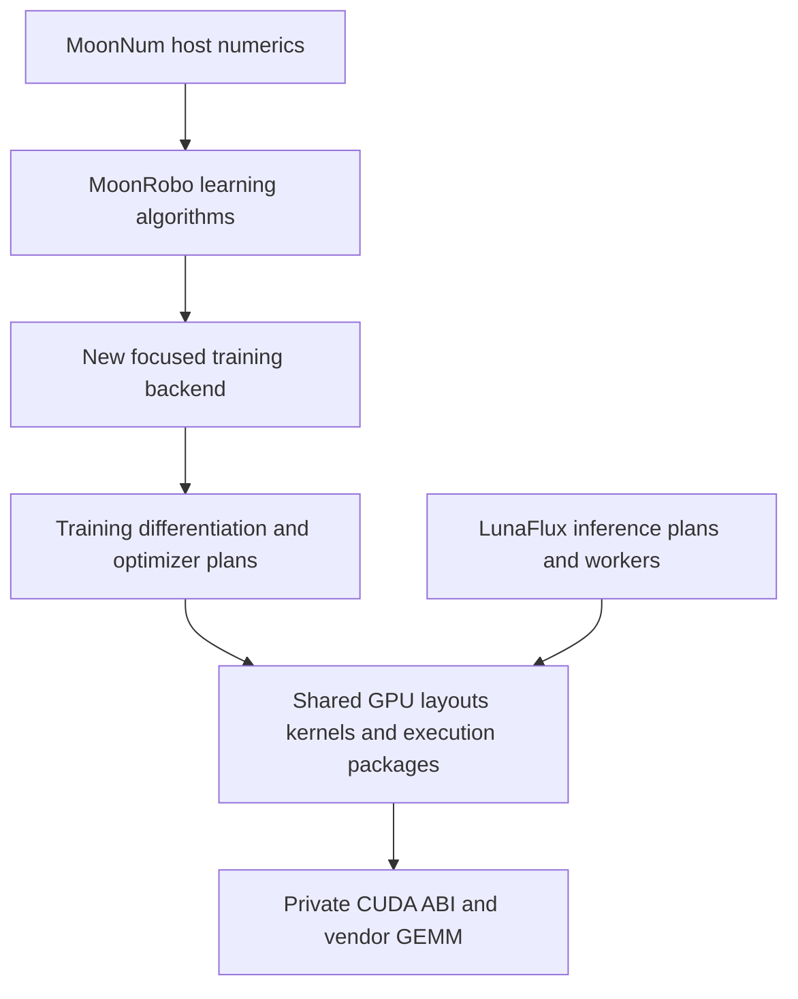

# Future LunaFlux based GPU training backend

Status: deferred alternative · 2026-11-17

This is a design proposal. Source paths below identify the original learning
workspace and sibling LunaFlux checkout, not new training code published by
the E1 archival series. Current deployment evidence is in the
[19 November findings](E1_COMMISSIONING_FINDINGS.md).

The selected architecture is
[LunaKine actor deployment and LunaFlux LLM integration](LUNAKINE_DEPLOYMENT_PLAN.md).
MoonRobo keeps LibTorch/CUDA training and E1 control, LunaKine is a separate
actor-runtime repository for Ascend inference, and LunaFlux handles LLM
inference. The training replacement explored below is deferred and does not
block that architecture.

MoonRobo could replace LibTorch with a focused native training backend built on
GPU infrastructure shared with LunaFlux. This requires new differentiation,
backward kernels, optimizer execution, and training state management. LibTorch
remains the current GPU training backend until the replacement passes the
numerical, resource, resume, and performance gates below.

## Current execution path

The device learner in [`src/learning_aligned_gpu`](../src/learning_aligned_gpu/README.md)
implements world-model, actor, and critic training in MoonBit. It calls
[`src/learning_tensor`](../src/learning_tensor/README.md), whose C loader opens
a C++ LibTorch plugin. LibTorch supplies ATen tensors, automatic differentiation,
Adam, CUDA execution, and the tensor integration used by our custom CUDA kernels.
The native learner does not require a Python interpreter.

The separate `learning_numeric` facade uses MoonNum for host numerics and scalar
training. Its Tape is not a device differentiation engine. Physics collection
has its own backend selection; replacing the tensor backend does not replace
MuJoCo or the native APIC simulation path.

LunaFlux owns an inference engine with CUDA lifecycle management, typed numeric
and execution plans, AOT kernel generation and selection, and workspace planning.
Its current [product contract](../../lunaflux/docs/PRODUCT_CONTRACT.md) excludes
training and arbitrary graph execution. Its kernel and planning infrastructure
can inform a shared backend, but its serving API cannot execute this trainer.
Any extraction must retain explicit precision, allocation and ownership
constraints across the two runtimes.

## Proposed ownership and dependency direction

Extract reusable GPU execution packages with a supported public interface.
LunaFlux and a MoonRobo training backend would both depend on those packages.
MoonRobo must not reach through LunaFlux's private CUDA ABI, and LunaFlux must
not acquire a dependency on MoonRobo, its AD state, or its training loop.
Package names and extraction boundaries remain to be designed.

The shared layer should own device buffers and views, explicit resource release,
streams and events, kernel launch contracts, and reusable AOT compiler machinery.
Training owns activation and gradient lifetimes, mutable parameter versions,
backward execution, and optimizer state. LunaFlux retains serving, scheduling,
KV caching, and sampling. A separate training layer preserves LunaFlux's
inference scope and allocation constraints.

Retain CUDA and vendor GEMM support where useful. Removing LibTorch does not
require replacing cuBLASLt or writing every matrix multiplication kernel.
Start with the operations and shapes used by MoonRobo rather than attempting
full PyTorch compatibility. Static forward and backward plans are a candidate
for the known networks and horizons; a universal eager graph engine is not a
prerequisite.

## Capabilities required beyond the inference infrastructure

| Area | Required training work |
| --- | --- |
| Tensor semantics | Device storage, views, strides, broadcasting, batched matmul, indexing, reductions, concatenation, casts, alias rules, and checked shapes for the actual learner workload. Existing inference kernels require a coverage and numerical audit. |
| Differentiation | Reverse-mode AD or generated backward plans, vector-Jacobian products, saved intermediates, gradient accumulation, detach and stop-gradient semantics, frozen parameter views, and parameter version checks. |
| Backward kernels | Linear layers including weight and input gradients, LayerNorm, SiLU and other used elementwise operations, broadcast and reduction derivatives, and differentiable SO(3), forward kinematics, observations, rewards, and termination computations. |
| Optimizer | Adam moments, step counters, learning rates, epsilon and bias correction, gradient norm and value clipping, finite checks, and any enabled optimizer variants. |
| Training memory | Activation, gradient, optimizer, and scratch budgets across complete imagined rollouts; safe reuse, microbatch accumulation, and optional recomputation. Inference workspace reuse must account for values retained by backward. |
| Precision | Explicit storage, compute, accumulation, rounding, and output rules for the selected FP32 or BF16 path, including master weights or scaling if the chosen training policy needs them. BF16 inference support alone does not establish training support. |
| Checkpoint and resume | Weight and Adam serialization plus integration with learner normalizers, RNG, replay, histories, and counters. Existing LibTorch archives need an explicit conversion or continued legacy import path. |
| Distributed execution | Parameter broadcast, gradient reduction and averaging before clipping, shared normalizer statistics, matching collective order, failure handling, and separate distributed resume support. Inference tensor parallelism does not supply these semantics. |
| Custom extensions | Port existing ATen tensor and PyTorch autograd integrations to the new buffer, stream, lifecycle, and backward contracts. Reuse of CUDA arithmetic does not remove this integration work. |

## Actor gradients through frozen networks

The actor update differentiates through an imagined trajectory. World-model and
critic weights remain fixed during this update, but their input derivatives
must remain live so the actor receives gradients through model transitions,
geometry, rewards, survival weights, and the critic tail. Frozen weights do not
make these calls inference-only.

The replacement must preserve this behavior over the configured horizon,
including the existing 32-step path. Detaching the world model or critic output
would change the learning algorithm even if every forward value matched.
Reference points are the actor backward in
[`learning.mbt`](../src/learning_aligned_gpu/learning.mbt) and the derivative
boundaries in [`compiled_actor.mbt`](../src/learning_aligned_gpu/compiled_actor.mbt).
This requirement concerns the learned rollout; it does not introduce a new
requirement to differentiate through the physical simulator.

## Migration milestones

Each milestone requires its own measured result before expanding scope.
LibTorch remains an explicit selectable baseline during migration.

| Milestone | Deliverable | Exit criteria |
| --- | --- | --- |
| 0 Capture the contract | Inventory operations, shapes, dtypes, layouts, precision policies, custom kernels, enabled variants, and representative training configurations. Define the shared package boundary and initial resource budgets. | Fixed inputs, weights, noise, permutations, expected state transitions, numerical tolerances, and benchmark procedure are recorded before candidate comparisons. |
| 1 One world-model update | Shared GPU resource and GEMM foundation plus one MLP forward, backward, clipping, and Adam update. | Compare outputs, loss, input and parameter gradients, weights, moments, and steps with LibTorch; use independent derivative checks on small fixtures. Measure memory and time. |
| 2 Complete world-model fitting | Multi-step fitting, normalization, masks, minibatches, and selected precision policy. | Full update and short repeated-update comparisons pass, including actual workload shapes and invalid or nonfinite input behavior. Save and reload reproduce the candidate's next update. |
| 3 Actor rollout | Differentiable geometry, frozen world and critic input gradients, rewards, survival, and the complete imagined horizon. | Compare intermediate states, returns, actor gradients, clipping, and the parameter update. Verify frozen weights receive no updates and gradients still reach earlier actions and actor parameters. |
| 4 Critic and complete learner | Critic targets and GAE, update ordering, replay and normalizer integration, and complete single-GPU checkpoints. | Matched single-GPU iterations and restart continuation pass; resource use fits declared budgets. Evaluate saved actors in the same simulator and motion protocol. |
| 5 Distributed training | Gradient and statistics collectives, startup synchronization, failure cleanup, and explicit resume semantics. | Compare rank state and synchronized updates with the LibTorch baseline on eligible hardware. Claim distributed resume only after a separate restore gate passes. |
| 6 Backend promotion | User-selectable deployment path and documented legacy checkpoint support. | Numerical and training-quality acceptance, resource lifecycle checks, and representative performance comparisons pass. Remove mandatory LibTorch only from configurations with complete replacement coverage. |

A smaller optional experiment is standalone actor inference after export. It
can establish forward execution and artifact integration, but it does not
satisfy the training differentiation milestones. A temporary hybrid backend
would need explicit buffer ownership, stream synchronization, and custom
gradient contracts; sharing a device pointer alone is insufficient.

## Validation and promotion

Fix initial parameters, input batches, sensor noise, sample orders, and precision
policy for comparisons. Validate forward intermediates, losses, gradients, Adam
state, and complete updates before comparing longer training trajectories.
Define tolerances per dtype and reduction order; do not assume bitwise equality
across different floating-point programs. Use independent finite-difference or
analytical checks for small derivative cases, including geometry edge cases.

Exercise view aliasing, stale parameter versions, missing and nonfinite
gradients, partial initialization failures, cancellation, and deterministic
resource release. Test activation reuse and microbatch paths against the same
mathematical update. Run the relevant native ABI, sanitizer, and resource-balance
checks when those boundaries change.

Measure synchronized GPU timing, whole-iteration wall time, kernel launches,
host transfers, and peak device and host memory at representative shapes.
Use the same hardware, workload, precision policy, and physics backend for both
backends. Report tensor execution separately from physics collection so a
simulation bottleneck cannot hide a training regression. Set promotion budgets
before evaluating performance; a native implementation does not imply a speedup.

Single-update agreement establishes local numerical behavior. Sustained runs
across fixed seeds and the existing physical evaluation protocol are required
to assess training stability and policy quality. Checkpoint continuation and
distributed behavior remain separate acceptance criteria.

## Initial work package and open decisions

The first implementation package is milestone 0 followed by milestone 1 on one
GPU with FP32 and fixed batches. Defer mixed precision, collectives, and the full
actor rollout until that complete update is correct and measured.

Resolve the shared module location and public API, generated backward versus
tape execution, supported shape classes, initial hardware target, numerical
tolerances, resource ceilings, and legacy archive conversion policy during
milestone 0. Keep scope tied to the existing learner and its enabled features.
Performance, memory savings, and a delivery schedule require the first measured
prototype.
