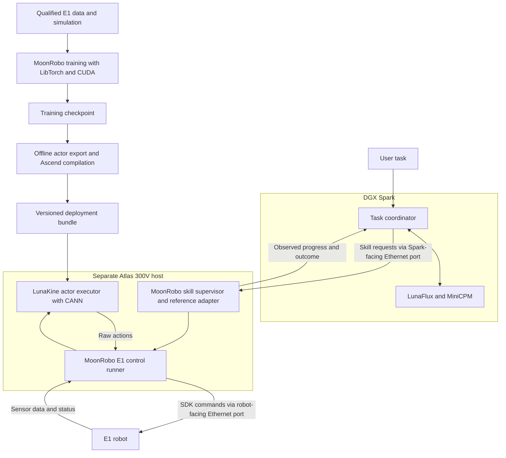

# LunaKine actor deployment and LunaFlux LLM integration

Status: selected architecture; dated deployment evidence updated 2026-11-19

The [commissioning findings](E1_COMMISSIONING_FINDINGS.md) are the current
hardware/SDK and real-elbow record. The actual Atlas is a 310P3; CANN 9.1 and
sampled actor inference passed after reboot. Spark native text/vision, sampled
upstream text comparison, JSON/SSE serving and two-host recorded shadow tasks
passed. Later supervised deterministic elbow trials also completed, separately
from the actor/LLM path. Balanced actor control and general physical handback
qualification remain open. Historical milestone wording below retains its
original scope; use the findings and phase history for later results.

Some implementation links below identify packages in the original staging
workspace or sibling repositories. They describe architecture/source locations;
this focused E1 archival series does not publish those independent training,
LLM and actor-runtime implementations. Raw `output/` reports stay external.

Implementation sequencing and current evidence are tracked in the
[phase plan](LUNAKINE_IMPLEMENTATION_PLAN.md). Software work starts locally;
hardware acceptance follows when the Spark/300V/E1 setup is available.

Train the E1 policy with MoonRobo's existing LibTorch and CUDA learner. Export
the frozen actor into a portable inference artifact and execute it on Ascend
through **LunaKine**, a separate actor runtime repository named `lunakine`.
The selected deployment uses a DGX Spark for LunaFlux and **MiniCPM-V 4.7
35B-A3B**, prioritizing flagship robot perception/planning capability, and a
separate Atlas 300V host for LunaKine and MoonRobo's E1 control runner.
LunaFlux handles LLM inference. MoonRobo owns actor training, export,
observation construction, motion-reference progression, action conversion, and
E1 control. The local `lunakine` repository and first software implementation
now exist. Actual Ascend compilation and post-reboot actor inference pass on
the supplied310P3 host with CANN9.1.0. Spark also completes its first two full
MiniCPM text requests through native LunaFlux. Subsequent sampled upstream
comparison, vision/serving and recorded two-host results are documented in the
phase plan; broader model quality and physical actor qualification remain open.

This split requires neither Ascend training nor a replacement for LibTorch
training. The [Ascend training backend proposal](ASCEND_BACKEND_PLAN.md) and
[LunaFlux training backend proposal](LUNAFLUX_TRAINING_BACKEND_PLAN.md) are
deferred alternatives. They are not dependencies of the selected deployment.

## Repository ownership

| Repository | Responsibility |
| --- | --- |
| `moonrobo` | LibTorch/CUDA actor, world-model, and critic training; portable actor export; simulator evaluation; skill supervision; calibrated observations; reference generation; action conversion; E1 SDK integration and control. |
| `lunakine` | New MoonBit-native actor runtime; deployment bundle contract; model preparation and execution; private CANN/AscendCL bindings; device buffers, workspace, completion, resource release, and inference diagnostics. |
| `lunaflux` | LLM loading and inference, token generation, KV caching, and serving. It does not execute the E1 actor or own the robot control loop. |
| Existing task coordinator such as `moonclaw` | Calls the LLM to propose task steps and consumes execution feedback through MoonRobo's typed interfaces. LunaFlux supplies model inference rather than robot task authority. |

LunaKine has no dependency on MoonRobo's training packages, E1 SDK, or LunaFlux's
serving engine. MoonRobo consumes LunaKine's public actor API or bounded local
IPC interface. LunaFlux and LunaKine do not import each other. Share a small
independent library only when both have a concrete need for the same contract;
do not make a common compiler or device abstraction a prerequisite.

## Hardware placement and Ethernet connections

| Host | Services and responsibilities |
| --- | --- |
| DGX Spark | LunaFlux serving the selected MiniCPM model; the task coordinator; asynchronous task requests and outcome summaries. Target the 128 GB configuration and build native dependencies for its Arm CPU and GB10 GPU. |
| Separate Atlas 300V host | LunaKine executing the frozen actor through CANN; MoonRobo skill supervision, calibrated observations, reference progression, action conversion, E1 SDK connection, and the local 50 Hz control loop. The host has two Ethernet ports. |
| Offline CUDA training environment | MoonRobo's existing LibTorch/CUDA training and export. It may use a Spark in a separately scheduled workload; training is not part of the deployed LLM service or control loop. |

The Atlas 300V stays in its own compatible PCIe host. The Spark is a separate
computer, not the card's expansion chassis. Use wired Ethernet between hosts.
The [DGX Spark hardware guide](https://docs.nvidia.com/dgx/dgx-spark/hardware.html)
describes its Arm/Blackwell platform and Ethernet connectivity; the
[Atlas 300V specifications](https://www.hiascend.com/doc_center/source/zh/300Vtest/300VG/300V_0004.html)
identify a 310-series processor with 24 GB memory. Confirm the actual board
and reported SoC before selecting CANN and ATC targets.

Use the Atlas host's two Ethernet ports as separate network paths:

| Atlas host port | Connection | Traffic |
| --- | --- | --- |
| Spark-facing port | Directly to the Spark or through the task network switch | Typed skill requests, acknowledgments, progress, and outcome feedback. Optional perception inputs remain asynchronous. |
| Robot-facing port | E1 development/control Ethernet connection | SDK sensor data, status, and motor commands. Bind SDK/DDS discovery and transport to this interface using the exact SDK's supported configuration. |

Assign distinct, non-overlapping subnets, preserve the E1's documented addressing,
and verify negotiated link speeds and routes. Use explicit service addresses
and interface selection so DDS does not discover or publish over the Spark-facing
port accidentally. Do not bridge the two networks or enable forwarding by
default. The task coordinator reaches the robot through MoonRobo's typed
interface, rather than direct access to the robot subnet.

Both sensor-to-actor calls and action-to-SDK delivery stay on the Atlas host.
The Spark sends skill-level requests, not a stream of per-tick joint commands.
Network separation reduces contention but does not establish timing: measure
SDK delivery and the full local control period under task-network load.

## Spark MiniCPM qualification

The selected model is `openbmb/MiniCPM-V-4.7-35B-A3B`, revision
`98e79ba972b586ac6146d3505771ce1467e199ba`, from the
[official flagship model card](https://huggingface.co/openbmb/MiniCPM-V-4.7-35B-A3B).
Pin its tokenizer, processor, chat/tool format, context limit, precision, CUDA
stack and LunaFlux build. It requires hybrid attention, routed/shared experts
and a compressed vision encoder; small MiniCPM5-2B tests do not satisfy this
integration. Begin with structured text skill selection using the same flagship
decoder, then add vision inputs. Prefer BF16 initially and qualify later precision
changes against capability and task quality. See the
[flagship workstream](../../lunaflux/docs/MINICPM_V47_SPARK.md).
More memory does not establish model support or task accuracy.

LunaFlux has execution history on Sparks for other model families, but MiniCPM
integration remains a separate implementation and validation task. GB10 is
`sm121` according to [NVIDIA's capability table](https://developer.nvidia.com/cuda/gpus);
qualify the exact target artifacts rather than applying `sm120` evidence to it.
Check original-model numerical behavior, tokenizer/chat handling, bounded
generation, cancellation, and valid skill output before connecting the robot
task interface. Use recorded or simulated state for the first acceptance run.

## Target execution flow

Use a native in-process actor API for the first deployment. Do not route control
ticks through text-generation HTTP, token scheduling, or KV-cache machinery.
If SDK isolation requires separate processes, define a bounded local IPC
protocol with sequence numbers, deadlines, and explicit ownership of control.
Keep the timing-critical runner on the robot's compute host or a qualified
directly connected host; fleet networking is not the control transport.

## Actor contract and export

Use the E1-specific actor from
[`learning_e1_training`](../src/learning_e1_training/README.md), not an unchanged
G1 checkpoint. Confirm the physical robot's joint profile before freezing the
deployment contract: the current code has 23-axis and 24-axis simulation profiles
within a masked 29-axis internal representation.

The current E1 learner uses 10 history frames of 99 observation values and a
10-frame reference preview of 73 values per frame. At batch one, the actor
accepts history `[1,10,99]` and preview `[1,730]`. Its encoder uses ELU hidden
layers and a tanh latent; its decoder uses ELU hidden layers and a linear output.
Saved observation and goal normalization, concatenation order, and the action
mask are part of the forward program. The internal output is 29 actions;
MoonRobo maps the declared active entries to physical E1 joints.

These dimensions describe the current E1 path, not a universal model format.
Bind each export to its actual checkpoint schema, dimensions, profile, joint
order, units, observation frames, history reset rules, reference alignment,
normalizers, action scales, calibration, and precision policy. Keep setpoint
conversion and command limits in MoonRobo and do not apply them twice.
The actor has no training world model, critic, replay, optimizer, or backward
graph in deployment. World-model SiLU and LayerNorm are outside this actor's
minimum operator set.

The existing actor archive is a custom LibTorch archive, not ONNX or a
LunaKine-ready artifact. Add a new offline converter that reads it with the
training stack and produces named portable weights, an actor manifest, and a
static inference graph. Safetensors is a candidate for portable weights;
the graph must explicitly represent the actual actor program rather than infer
semantics from tensor names. Preserve the original checkpoint for reference.

Publish a deployment bundle containing the manifest, portable actor graph and
weights, target-compiled artifact, numerical policy, and input/output fixtures.
Record the source generation, target SoC, compiler/runtime compatibility, and
artifact version. Conversion must not depend on loading LibTorch at deployment.

## LunaKine MLP executor and Ascend backend

Create the `lunakine` repository with its own module, runtime contract, native
ABI, artifact schema, and focused validation. Add a public native API with
prepare, run, and close operations, plus explicit episode reset semantics where
the executor owns state. The first actor graph is stateless: MoonRobo owns its
history and motion phase. Preparation validates the actor and target, loads
immutable weights or a compiled model, and allocates bounded input, output,
and workspace storage. A run receives
fixed-shape numeric inputs and returns raw numeric actions. Make completion
and resource lifetime explicit. Keep inference free of autograd, TorchNPU,
LibTorch, and Python dependencies in the production process.

Direct LunaFlux code reuse is limited: checked shape/storage utilities and
safetensors metadata handling are candidates, subject to dependency and semantic
review. A compiled whole-model deployment may not need a safetensors reader at
runtime. LunaFlux's `device` package imports private CUDA and NCCL packages,
and its precision IR includes attention and parallel dependencies. Its CUDA
kernels cannot execute on Ascend. Reuse lifecycle and capability design ideas
without importing the whole engine or copying an unneeded compiler stack.
Any shared implementation must have one independent owner rather than two
diverging copies. LunaKine's minimal Ascend build must not initialize CUDA or
NCCL. LunaFlux requires no actor API, model-scope expansion, or device refactor
for this deployment.

The recommended first implementation uses an AOT compiled whole-model artifact:
export a static ONNX actor graph offline, compile it with the selected CANN ATC
toolchain, then execute the resulting model through a private AscendCL C ABI.
LunaKine owns actor admission, execution, buffers, and lifecycle; CANN supplies
model compilation and device execution. This route must pass exact-card
operator and precision checks before it is adopted.

Huawei documents [ONNX to offline model conversion](https://www.hiascend.com/doc_center/source/en/canncommercial/700/inferapplicationdev/aclcppdevg/aclcppdevg_0006.html)
and [AscendCL model execution](https://www.hiascend.com/doc_center/source/en/canncommercial/5046/inferapplicationdev/aclcppdevg/aclcppdevg_000069.html).
Offline conversion tools may have different dependencies from the production
runner. Pin the actual card, driver, CANN, compiler, host ABI, and supported
operator set together.

If whole-model conversion cannot preserve the actor contract or timing, evaluate
an explicit ACLNN operator plan inside the same LunaKine executor. CANN exposes
[matrix multiplication APIs](https://www.hiascend.com/document/detail/en/canncommercial/850/API/aolapi/context/ops-nn/aclnnMatmul.md),
but coverage, workspace, precision, and per-call overhead require measurement.
Custom Ascend C kernels are a later optimization, not the first prerequisite.
Do not port LunaFlux CUDA kernels or its entire language-model serving stack.

Use vllm-ascend for Ascend compatibility, layouts, synchronization, profiling,
and operator integration lessons. Its Transformer inference plugin is not the
actor runtime, and its TorchNPU dependency is not required by the proposed
native AscendCL deployment route.

## LLM and actor cooperation

Combine the models through a hierarchy, with an explicit intermediate command
contract. The task coordinator uses a LunaFlux-served LLM to propose a skill and
bounded parameters from MoonRobo's qualified catalog. MoonRobo validates the
request, builds the numerical motion reference, and calls LunaKine on every
actor tick. Language output and arbitrary embeddings are not inputs to the
current actor.

The initial skill contract names the catalog revision, skill/reference ID,
request sequence, relevant robot-state version, expiry, completion criteria,
and allowed parameter ranges. MoonRobo reports accepted, running, completed,
failed, or interrupted states from observed execution. It validates skill
transitions and keeps stale LLM proposals from replacing newer requests.
Only expose skills the selected actor and robot profile actually support;
language planning does not add navigation, grasping, or perception abilities.

LLM planning happens on task or skill events and never blocks the actor's
50 Hz loop. The actor runtime executes the latest accepted numerical inputs;
MoonRobo handles reference exhaustion, interruption, and fallback. Test loss or
stalling of the LLM service independently from actor failure. In the selected
topology the LLM runs on the Spark and the actor runs on the separate 300V host.
On task-link loss, MoonRobo applies the accepted skill's bounded expiry and
locally defined completion/interruption behavior; it does not wait for new LLM
tokens or replay an expired request after reconnection. Qualify these cases
without changing the robot link or actor schedule. An all-Ascend LLM deployment
or shared-accelerator topology is outside this plan's initial scope.

Train the actor independently with LibTorch/CUDA and begin with structured LLM
skill selection. Language-conditioned policies or learned latent interfaces
require new training data and actor contracts; they are later research work.
Vision-dependent tasks likewise require qualified perception or a VLM.

## E1 control runner

Maintain calibrated sensor interpretation, oldest-to-newest observation history,
reference preview, and previous-action state in MoonRobo on the 300V host.
Bind SDK traffic to its robot-facing Ethernet port. Define startup/reset,
reference exhaustion, inference failure, stale sensor, and missed-deadline
behavior explicitly. The current policy assumes 50 Hz control, giving a 20 ms
period for the entire sensing-to-command path. Set the inference allocation
within that period only after measuring SDK and preprocessing costs.

Use preallocated host staging and device buffers after preparation. Include
input transfer, synchronization, output transfer, and command delivery in timing;
kernel-only latency is insufficient. Validate tail latency and deadline misses
at batch one rather than optimizing throughput with extra control delay.
Load and warm the model before enabling policy control.

The existing product bridge publishes high-level WALK/RUN commands and does not
deliver policy joint targets. Add a dedicated low-control runner for the exact
SDK and firmware, with exclusive ownership, bounded setpoints and gains,
watchdog behavior, and verified stop/hold/takeover semantics. Reconcile the SDK
version mismatch recorded in
[`E1_SUPERMIMIC_TRANSFER.md`](E1_SUPERMIMIC_TRANSFER.md). Current offline E1
training and simulation evaluation do not establish physical qualification.

## Implementation milestones

| Stage | Work | Required result |
| --- | --- | --- |
| 0 Freeze deployment and repository contracts | Specify the new `lunakine` repository and public artifact/API boundary. Inventory the DGX Spark and separate dual-Ethernet Atlas 300V host, exact SoC, subnets, and SDK interface binding. Confirm physical E1 joint profile, firmware, observations, and actuator mapping. Freeze the MiniCPM and actor checkpoints and timing/precision budgets. | Explicit repository ownership and two-host deployment contract; both network paths resolve to the intended interfaces; no assumed 23/24-axis equivalence. |
| 1 Portable actor export | Decode the existing archive offline and emit actor manifest, weights, graph, and fixed fixtures. Include normalization, ELU, tanh, concat/reshape, linear layers, and mask. | Exported forward values and physical-action mapping match the LibTorch actor on recorded and edge-case inputs under declared tolerances. |
| 2 Atlas 300V proof of execution | Compile the batch-one actor for the installed card's reported SoC and execute it on the 300V host with a small native AscendCL probe. Compare candidate precision modes. | Correct outputs, confirmed NPU execution, reproducible memory use, and complete transfer-inclusive timing. Reject incompatible target or precision configurations. |
| 2a Spark MiniCPM qualification | Implement or complete the selected model adapter and qualify LunaFlux on the Spark's exact GB10 target and Arm environment using simulated state. This can proceed independently of the actor probe. | Numerical/model-format checks, bounded context and memory, cancellation, and valid structured skill proposals pass; other Spark model results do not substitute for MiniCPM acceptance. |
| 3 LunaKine runtime | Create the separate repository and implement its public actor interface, private Ascend lifecycle, model loading, buffer reuse, and diagnostics without CUDA initialization or training dependencies. | LunaKine output matches the probe and LibTorch reference; repeated run/close, failure cleanup, and memory/resource checks pass. |
| 4 MoonRobo simulation integration | Add an explicit LunaKine/Ascend inference choice to the E1 evaluator and replay runner. Keep training on LibTorch/CUDA. | Identical recorded-input comparisons plus closed-loop CPU MuJoCo evaluations using the same E1 actor, assets, references, and reset protocol. |
| 5 Hardware runner qualification | Implement exact-SDK low control on the 300V host's robot-facing port, calibrated observations, deadlines, watchdog, and takeover. Test recorded telemetry, device stubs, and shadow inference before any actuation trial. | Local sensing-to-command timing and command behavior pass under Spark-link traffic and outages, including missing/stale input and inference failure; supervised trials use the qualified E1 policy and controls. |
| 6 Deployment support | Package the target bundle and runner, startup checks, telemetry, rollback, and supported compatibility matrix. | Sustained operation and task-quality acceptance on named hardware; previous known-good artifacts can be restored without automatic model substitution. |
| 7 Two-host LLM skill integration | Connect the Spark task coordinator and LunaFlux/MiniCPM to MoonRobo on the 300V host through its Spark-facing port. Start in simulation with one qualified skill, then add validated transitions. | Structured requests are grounded in available skills; stale/duplicate/invalid proposals are rejected; outcome feedback closes the loop; LLM delay, disconnect, and reconnect do not interrupt actor deadlines or replay expired commands. |

## Validation and initial scope

Separate recorded-input numerical comparisons from closed-loop comparisons:
small action differences can produce different future trajectories. Compare
normalized inputs, encoder latent, decoder output, masked actions, and converted
joint targets before assessing full-clip returns, terminations, and physical
behavior. Check repeat-first history initialization, preview ordering, joint
masking, calibration, and boundary inputs. Do not silently use BF16/FP16 because
the NPU prefers it; qualify any inference precision change against the chosen
FP32 or mixed-precision training reference.

Start with one frozen E1 actor, batch one, one Atlas 300V, static shapes,
and CPU MuJoCo evaluation. Run the selected MiniCPM with LunaFlux on the DGX
Spark, with the 50 Hz E1 loop local to the dual-Ethernet 300V host. No Ascend
training, optimizer port, distributed execution, attention/KV implementation
for LunaKine, or simulator port is required.
Hardware availability and the conversion/timing probe determine the schedule.
The first concrete work package is the portable export and exact-card native
probe; integrate the full control runner only after that result is viable.
