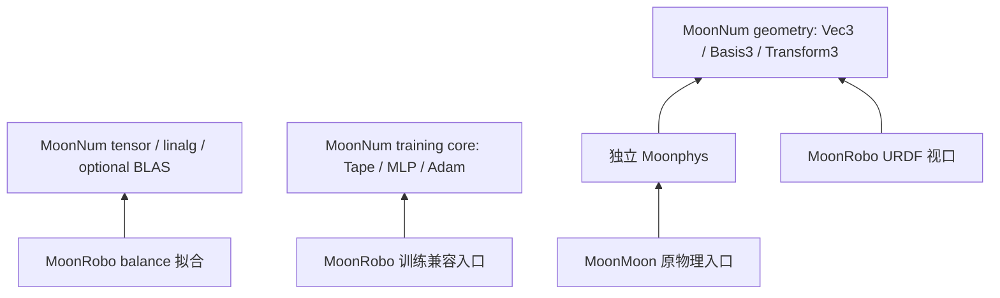

# MoonNum / Moonphys 独立库与机器人训练接入

这轮工作把 MoonMoon 原有通用物理核心提取为独立模块，并建立实际由物理和训练共同使用的数值层。Python 对照实现和实验数据保留。测试、训练、仿真、SDK/设备初始化、数值样例和性能测量均暂不执行；类型检查与源码生成不代表数值验证。

## 模块与所有权

| 模块 | 本地源码 | 职责 |
| --- | --- | --- |
| `vectie/moonnum@0.1.0` | `../moonnum` | 专用训练数值核心、数组/视图/广播/归约、矩阵运算与求解、可选 CBLAS、三维几何 |
| `vectie/moonphys@0.1.0` | `../moonphys` | 刚体、碰撞接触、关节/电机、地形与支撑评估、物理回放审查 |
| `vectie/moonrobo` | 当前仓库 | 机器人业务、数据、学习算法、实验协议与原生适配 |
| `vectie/moonmoon` | `../moonmoon` | 月面/任务领域与原物理包的兼容入口 |

两个新库是本地独立 MoonBit 模块，尚未发布。当前工作区用 `moon.work` 选择本地模块；不要把未发布的版本误认为已能从公共包仓库下载。MoonNum 不依赖机器人、物理产品、Python 或 LibTorch。Moonphys 仅依赖 MoonNum，且几何子包不依赖 AD。训练与 Moonphys 不互相导入。

## 实际共享调用

- `src/learning_numeric` 仅转发 MoonNum 的 canonical 类型和函数，所有原训练消费者继续使用同一实现。旧源码、接口和测试全文及 SHA 保存在 `docs/migration-baselines/shared-numerics/learning-numeric-before-moonnum.json`。
- MLP 仿射层使用块级反向传播；推理路径直接计算前向，不建立 AD Tape。现有网络层参数排列和 checkpoint JSON 字段保持。图分配、浮点归并顺序和性能仍需以后比较。
- balance 最小二乘调用共享线性代数实现。原重正交 QR 改为带列主元 Householder QR，秩阈值与条件数估计语义已在库文档标明；这不等于 NumPy/PyTorch 的 SVD 最小范数解。
- Moonphys 的 `Vec3`、`Basis3`、`Transform3` 及方法由 MoonNum geometry 唯一拥有。Moonphys 保留物理类型与算法，MoonMoon 的原包路径转发到独立库。原物理源码快照及逐 API 映射位于独立库迁移文档。
- MoonRobo URDF 视口的三维变换也调用共享 geometry，`ViewportBasis` 为 canonical `Basis3` 的公开别名，JSON 的九个矩阵字段保留。

URDF 视口原来按坐标逐个除以轴长；共享 geometry 先计算轴长倒数再逐个相乘。这可能引入末位舍入差异，须纳入变换结果复测；不声称逐 bit 不变。

## 兼容边界

目前只覆盖项目实际需要的 F32/F64 数值与三维数学，不声明 NumPy 全兼容。矩阵求解、秩亏处理、Float32 逐操作舍入、广播写入别名、负步长视图等规则应按 MoonNum API 文档使用。

CBLAS 是显式可选后端；不要把一次函数成功返回视为精度或加速证明。CPU/Double 训练与原 Torch float32 的梯度、优化器状态和学习结果仍待对照复测。Moonphys 保留原物理模型范围，本次拆分不会自动获得 MuJoCo/Newton 的动力学能力。

LunaFlux 的关系与可共享边界见 [SHARED_NUMERICS_LUNAFLUX.md](SHARED_NUMERICS_LUNAFLUX.md)。本轮没有更改 LunaFlux 生产运行时；它的 AOT、精度程序、无分配执行和 GPU owner 约束需要单独保持。

## 原生适配与差分源码

Isaac/Newton、CUDA、USD 与上游差分对应实现由 `src/learning_aligned` 和 `src/learning_differential` 的迁移文档记录。真实 SDK/CUDA/Kit、原始上游 oracle 和 fixture 需求必须逐项区分，不能以接口声明或同一实现复算证明完成。缺少 SDK 的代码路径应明确报错。

现有 `src/learning_aligned/cmd` 的 train/evaluate 入口显式选择配置中的 `backend=mujoco` 或 `backend=isaac`。后者通过 `--physics-library` 和 `--physics-artifact` 选择原生 Newton APIC 加载器及离线工件；`--library`、`--scene` 仍提供真实 MuJoCo 静态模型供机器人运动学使用。`device=cpu` 和 `amp=none` 指训练数值层，`physics_device_id` 独立选择仿真 GPU，`num_envs` 必须等于工件固化的世界数量。没有自动替换物理后端。Checkpoint 绑定模型、工件 manifest 和适配库 SHA；Newton 恢复明确采用新物理 episode 和 replay refill，不声称 GPU 精确续跑。

保留的 `isaac_env.py` 实际固定 IsaacLab 的 kit-less Newton/MuJoCo-Warp 路径；本次适配遵循该求解器。它不是任意 Omniverse Kit/PhysX 插件的通用绑定。构建期仍调用官方模型构建与 Warp 捕获工具，生成后的生产加载/步进路径不调用 Python。

最终 `scripts/finalize_python_migration.mbtx` 只做 native 类型检查、接口生成、格式化和源码/配置/fixture SHA 记录。`docs/MOONBIT_MIGRATION_INVENTORY.json` 包括两个独立库的实际源码。机器空闲后再执行独立库、兼容入口、共用算子、原生适配以及原 Python 的差分测试。

## 机器空闲后的验证顺序

| 阶段 | 必须核对的结果 |
| --- | --- |
| 共享算子 | 标量/块级 AD 梯度、重复使用值的累积、参数布局、归一化、Adam 裁剪与恢复、F32 舍入、负步长/广播别名、LU/QR 秩和溢出边界；CBLAS 单独选择真实库对照。 |
| 物理拆分 | 独立库保留的 102 个原测试，以及 MoonMoon 兼容入口、原消费者和 URDF 变换；从归档比对数值与 JSON。 |
| 学习差分 | 使用固定初值、窗口、噪声、permutation 比较 forward、梯度、Adam moments/step、8 步世界模型与 32 步策略更新；区分原上游输出和独立 C++ oracle。 |
| 原生适配 | 在匹配的 SDK/CUDA 主机先构建、验证真实 USD，再生成/加载 Newton 工件，核对 joint order、reset/context、四次 5ms 步进和 autoreset 前的 transition。 |
| 学习结果 | 在上述短程比较通过后进行原 Python 与 CPU/Double 的完整训练及仿真评测；单次前向或类型检查不能替代这一步。 |

本轮只补充、类型检查这些测试和工具源码，没有提前执行表中任何验证。LunaFlux 尚未接入共享库，相关设备和无分配约束应另按其项目合同验证。
