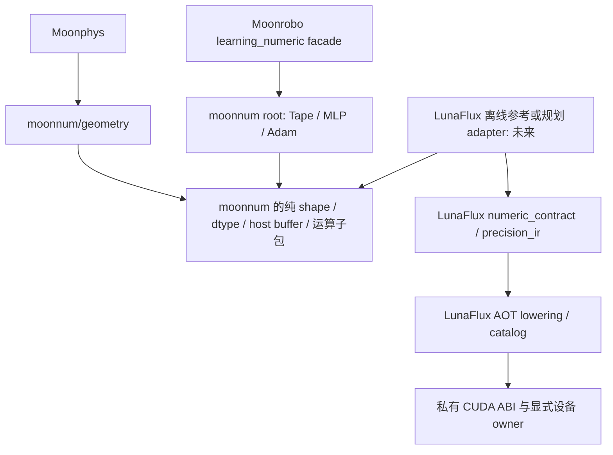

# Moonrobo、Moonphys 与 LunaFlux 的共享数值边界

当前选定架构见
[LunaKine actor deployment and LunaFlux LLM integration](LUNAKINE_DEPLOYMENT_PLAN.md)：
独立 `lunakine` 仓库负责 Ascend actor 推理，LunaFlux 负责 LLM 推理，MoonRobo
保留 LibTorch/CUDA 训练与 E1 控制。后文保留既有共享数值边界；
[LunaFlux based GPU training backend plan](LUNAFLUX_TRAINING_BACKEND_PLAN.md)
中的训练替换属于暂缓研究，不是 LunaKine 的前置依赖。

本次完成的是 Moonrobo 对独立模块 `vectie/moonnum@0.1.0` 的接入，以及
LunaFlux 的只读源码审查。没有修改 LunaFlux 的生产代码，也没有运行测试、
样例、训练、物理仿真或 benchmark。类型检查不能证明数值一致性或性能提升。

## 已经接入的实际调用链

- `src/learning_numeric/shared.mbt` 仅 `pub using vectie/moonnum` 的 `Value`、
  `Tape`、`Rng`、`MLP`、`Normalization`、`Adam`、`finite` 和
  `fit_normalization`。原三个本地生产实现文件已从编译包移除，没有两份权威实现。
  训练、temporal、reference 等原有调用通过兼容入口获得同一个 canonical 类型。
- canonical `MLP.forward` 使用块级 `Tape.linear` 记录仿射层反向传播；不再为
  每个权重乘法和加法各建一个标量节点。canonical `MLP.predict` 直接进行前向
  计算，不创建 Tape。图仍会分配数组，当前不声称其为无分配执行器。
- `src/learning_balance/heads.mbt:least_squares` 真正调用
  `vectie/moonnum/linalg.least_squares`。学习头和 sustained 腰部拟合共同走此
  Householder QR；调用端保留满列秩要求和单 RHS 返回形状。
- Moonphys 使用 `vectie/moonnum/geometry` 的 `Vec3`、`Basis3`、`Transform3`。
  geometry 是独立子包，不需要导入含训练 AD 的 root 包。MoonMoon 原入口和 MoonRobo URDF 视口已经接入同一几何类型。

旧源码、API、测试和 balance QR 源文本及 SHA256 保存在
[`migration-baselines/shared-numerics/learning-numeric-before-moonnum.json`](migration-baselines/shared-numerics/learning-numeric-before-moonnum.json)。
存档是非编译 JSON，可用于恢复旧实现和以后成对复测。采集脚本为
[`../scripts/capture_shared_numeric_baseline.mbtx`](../scripts/capture_shared_numeric_baseline.mbtx)，
拒绝覆盖已有 baseline。共享接入检查脚本仅执行 native `moon check`，不执行测试。

Checkpoint 的 JSON 字段、维度顺序、`Array[Double]` 参数存储和网络层顺序未改。
每层仍是 `[output,input]` 行主序权重，后接该层 output biases；Adam 的 first、
second、steps 等字段保持原语义。类型从 facade 转为 canonical 不引入模型参数
重排。块级反向传播改变梯度归并次序，不能据此声称梯度逐 bit 相等。

balance QR 的数值算法确实变化：旧代码为两遍重正交 modified Gram-Schmidt，
新共享实现为列主元 Householder QR，`rcond=1e-12` 相对最大初始列范数。
调用端继续拒绝秩亏。canonical 结果中的 condition_estimate 是 QR 对角估计，
不是 SVD 条件数；canonical 秩亏 basic solution 也不是 Moore–Penrose 最小范数解。
这没有补齐原 Python `gelsd`/SVD 的等价性，拟合结果须以后重新比较。

## LunaFlux 的权威边界

本次阅读了以下本地源码和文档；没有把文档中历史 campaign 的成功当成本次执行证据：

- [`AGENTS.md`](../../lunaflux/AGENTS.md)、[`README.mbt.md`](../../lunaflux/README.mbt.md)
- [`PRODUCT_CONTRACT.md`](../../lunaflux/docs/PRODUCT_CONTRACT.md)、
  [`ARCHITECTURE.md`](../../lunaflux/docs/ARCHITECTURE.md)、
  [`PLAN.md`](../../lunaflux/docs/PLAN.md)、
  [`DEBT_POLICY.md`](../../lunaflux/docs/DEBT_POLICY.md)
- [`model/numeric_contract`](../../lunaflux/model/numeric_contract/README.mbt.md)：
  `types.mbt`、`shape.mbt`、`vocabulary.mbt`、`construct.mbt`
- [`compiler/precision_ir`](../../lunaflux/compiler/precision_ir/README.mbt.md)：
  `expression.mbt`、`ordered_fold.mbt`、`dot_reduction.mbt`
- `kernels/reference/{basic,mlp,bfloat16}.mbt` 和
  [`kernels/catalog/numeric_v4.mbt`](../../lunaflux/kernels/catalog/numeric_v4.mbt)

LunaFlux 是推理执行引擎。模型加载、KV、调度、采样、AOT 内核与设备生命周期由它
拥有；训练、任意图执行和 Python/PyTorch 插件不属于其产品运行时。共享库不能把
Moonrobo 的实验日志、checkpoint pickle reader、训练配置或 AD Tape 带入其请求路径。

`model/numeric_contract` 把 storage、activation input、compute、accumulator、output
精度分开，还描述 scale/zero-point/codebook、转换和运算顺序。`NumericShape` 使用
受检 Int64 shape/byte 算术，标量 rank0 合法，显式维度为正。它不分配设备、不选择
内核、不授予硬件支持。这里的语义比一个 F32/F64 dtype 标签更完整。

`precision_ir` 的 `NumericExpr` 显式表示 RN 二元算子、FMA、Select、转换和具名
transcendental；`OrderedNumericFold` 固定 seed bits 和迭代顺序。
`DotReductionLaw` 区分 Ordered、Compensated、StripedTree、GroupedVector；它们是
不同数值程序，不能因为一次样例接近就互换。CPU 参考 dense 使用 Float accumulator；
其 BF16 decoder 是精确位展开。生产 BF16/FP8/I8 的 dtype、scale、舍入和 publication
边界仍由原 numeric contract 和 lowering 决定。

架构文档保留一些历史认证/构建叙述。当前 README 和 DEBT 明确区分 caller-supplied
association label 与 payload checksum，禁止请求路径或普通加载重做 payload hashing。
共享接入不得把 Moonrobo 的离线 SHA provenance 机制移植为 LunaFlux runtime admission。
小型新建离线编译 identity 与运行时全文件重扫是不同工作。

## 可共享内容及适配要求

| 可共享的底层内容 | 当前落点 | LunaFlux 接入前必须保持的语义 |
|---|---|---|
| 受检 shape、stride、offset、连续布局和广播规则 | `moonnum/tensor`，对照 LunaFlux `NumericShape`/typed tensor view | Moonnum 当前 host Tensor 使用 Int 索引；LunaFlux schema 使用 Int64 和独立 byte ceiling。显式转换并检查溢出，不能直接别名替代。零 extent、rank 限制和广播写入 alias 规则须单独固定。 |
| F32/F64 host buffers、view/reshape/transpose/slice | `moonnum/tensor` | 目前包含 Array 复制与 owned storage，没有设备地址、alignment、lease 或 memory space。仅适合离线参考和 host 数据处理；不可充当 GPU tensor owner。 |
| dense matvec/matmul、逐元素 add/mul、SiLU、归一化基础运算 | `moonnum/tensor`、root MLP 的现有底层循环 | 保留权重 `[out,in]` 和 `X*W^T` 约定；明确 bias seed、求和顺序、每次乘加的舍入、是否允许FMA、输出 cast。LunaFlux gated MLP 不是 Moonrobo 的普通多层 SiLU 网络。 |
| 线性求解、多 RHS QR least squares | `moonnum/linalg` | 是 F64 CPU 数值工具，适用于离线拟合/校准。保留 rank/rcond/condition estimate 语义；不能替代 GPU GEMM，也不能冒充 SVD 最小范数。 |
| 几何 Vec3/Basis3/Transform3 | `moonnum/geometry` | Moonphys 与机器人 FK 可共享，语言模型内核通常无需此依赖。共用实际坐标/矩阵运算，而非强迫模型架构使用几何类型。 |
| RNG 状态与可复现 seed 工具 | canonical root `Rng` | 只在离线训练复用当前 xorshift/Box–Muller；不得替换 LunaFlux 采样或媒体初始噪声算法。seed 含义与 plan association 必须分离。 |
| BF16/FP8/I8 转换和 ordered/compensated fold 语义 | LunaFlux 已有 numeric contract / precision IR | 适合未来提取为独立无设备/无AD数值语义包；这次未迁移。要连同 rounding、subnormal、NaN、signed zero、scale/发布边界迁移，不能只复制 enum 名称。 |

当前 `moonnum/tensor` F32 storage 与 Float32 数值程序仍需区分：基本二元操作在
返回边界 cast，sum 和 matmul 显式按声明 dtype 舍入累加（matmul 乘积也分别舍入）；
map callback 和部分 transcendental/复合表达式仍在 Double 内部求值后 cast。它不
保证 LunaFlux 的目标 `expf`、FMA、BF16 publication、FP8 scale 或指定树形 fold。
例如先在 Double 算完 SiLU 再转 F32，并不等价于逐 F32 除法/指数/加法程序。
共享 Tensor 当前也不覆盖 BF16/FP8/I8 storage。不能用它静默替换 LunaFlux 精度层。

## 无分配与 AOT 的必要分层

建议保留如下依赖方向。图中的 LunaFlux adapter 是建议，**本次没有新增该依赖**。

图中公共纯运算子包可以继续细分，geometry 当前是独立实现叶包，不反向依赖 AD。
推荐把可复用前向 kernel API 设计为调用方提供 output/scratch 的 `*_into` 接口，
在启动期检查 shape/alias/容量，热路径接收有界 view 与预分配 workspace。当前
`Tensor::to_array`、`clone`、`reshape` 的复制路径、逐次 map、QR 和 Tape 建图都有
分配，不能带进 LunaFlux token step。`MLP.predict` 不建 Tape 也不意味着无分配。

LunaFlux steady-state token step 禁止一般 heap allocation、字符串构建/解析、
hash-map 增长、文件/网络阻塞、JIT 和无界队列。共享库应提供执行数学运算所需的
纯布局与算子，GPU资源的 acquire/close、stream/event、KV、generation/stale-ID 和
取消后的清理由 LunaFlux 原 owner 继续负责。不要在通用 Tensor 内隐藏 CUDA handle、
GC finalizer、自动设备选择或 BLAS 动态加载。

GPU 代码继续由 LunaFlux 的离线 specializer -> typed IR -> AOT source/artifact ->
精确 catalog/launch contract 路径产生。共享 portable kernel 可以充当离线标量参考，
不能根据一次运行的数值接近、设备探测或 measured winner 在请求中替换运算顺序。
可选 CBLAS 使用显式 backend 选择和明确 portable fallback；生产路径不允许静默
降精度/慢路径。训练根包可以使用 AD，推理只依赖无 AD 的叶包；更不能引入 ATen。

## 静态验证与尚未执行的比较

`learning_numeric` facade 与 balance 共享 QR 的 native typecheck 已通过。
`scripts/check_shared_numerics.mbtx` 已 typecheck 全部64个迁移包，未执行测试。
本地 `moon info` 和 `moon fmt` 已更新 facade、balance 包及两个脚本，生成接口仅
保留 canonical 类型转发；info 有既存迁移/弃用警告，不声称 warning-denied 通过。
最终统一清单由 `scripts/finalize_python_migration.mbtx` 生成。没有跑数值样例或测试；尚无加速、内存下降、
Float32 等价、梯度逐 bit 等价、训练复现或 LunaFlux 设备兼容性的实测结论。

以后机器可用时，应先比较归档旧实现与 canonical 的参数布局、forward、梯度、Adam
状态、秩边界和 full-rank OLS，再分别进行 F32/BF16 转换与声明 fold 的差分比较。
LunaFlux 的 logits/token/quality、native sanitizer、资源平衡、无分配与 end-to-end
benchmark 仍按其 PLAN 的对应边界验证，不能从 Moonrobo 的类型检查推导出来。
