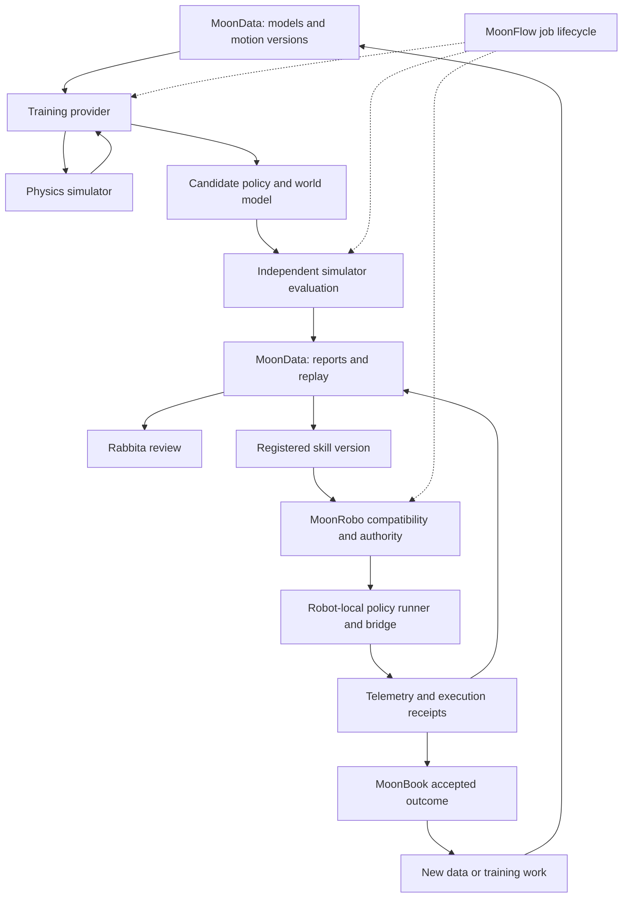

# SuperMimic Integration Design

Status: local data, dynamics and policy feedback development in progress. Reviewed: 2026-10-23.
Repository baseline: `22ef620cf6724abf03e5a5e58dc213ba2a124dd8`.

The current implementation priority is the [method-aligned baseline](G1_SUPERMIMIC_ALIGNED_BASELINE.md).
The nine-reference CPU experiments below are custom control ablations, not a
reproduction of the paper. A separate provider now uses 40 real LAFAN1 retargets,
matching G1 assets, default-pose scaled actions, Appendix A rewards and relative
termination, soft survival, and imagined GAE critic/tail updates. Full-clip
normalized returns are distinct from the legacy strict RMSE gate. CPU smoke
and exact checkpoint continuation are verified; trained control quality,
large-scale GPU execution, BONES-SEED and hardware qualification remain open.

Use SuperMimic's learning approach to add a motion-skill development lifecycle:
versioned motion data, simulator training, independent evaluation, skill
registration, bounded deployment, and outcome-driven improvement. The first
milestone is a simulation-only experiment with one robot body and a small
flat-ground motion library. E1 deployment follows separate adaptation and
hardware qualification.

The [phase plan](SUPERMIMIC_PHASE_PLAN.md) owns sequencing, task identifiers,
dependencies, and acceptance evidence. The [product contract](PRODUCT_CONTRACT.md)
continues to own physical authority. This design does not enable learned-policy
actuation or change the existing bridge's capabilities.

The [numeric data slice](MOTION_LEARNING_DATA.md) now supplies a MoonBit reader,
split-aware window materializer, and CLI with a synthetic example. It is partial
SM-1 progress; the gaps in the baseline table below remain until explicitly
implemented and evaluated.

The [G1 CPU physics slice](G1_CPU_PHYSICS.md) now supplies actual simulator
transitions, procedural reference trials, scoring and replay. Simple controls
still fall. A [PPO baseline](G1_PPO_BASELINE.md) now trains in that simulator
and provides a shared-suite final-checkpoint comparison; it still falls too.

The [differentiable dynamics slice](G1_DYNAMICS.md) now fits a residual model
from noisy simulation windows and verifies held-out errors and eight-step input
gradients. The [policy workflow](G1_POLICY_LEARNING.md) adds actor/critic training,
independent physics selection, new policy trajectories and model refitting.
Control qualification, a matched PPO learning-efficiency comparison and complete
product integration remain incomplete.

The later [temporal PPO comparison](G1_TEMPORAL_PPO_STUDY.md) now uses the same
supervised preview actors and initial calibrated finite-task values as the
temporal model studies. All three final policies remain unqualified, with
31,446 actual training transitions retained. A train-only exploration
calibration shows that noise worsens control and incoming policies also lack
noise-free train-family coverage. This supports improving initialization under
disturbance before extending the quality/cost comparison.

The [disturbance initialization comparison](G1_DISTURBANCE_INITIALIZATION.md)
now adds 432 actual clean/noisy student episodes with separate teacher labels,
fixed supervised update budgets and independent noise audits. More noisy-arm
seeds select updated weights, but all six final actors remain unqualified.
Both supervised cells register with their complete training and audit records;
more collected states alone have not solved the closed-loop control gap.

The [balance-channel diagnostic](G1_BALANCE_INTERVENTION.md) then freezes these
actors and substitutes selected teacher outputs. Four-ankle replacement removes
the observed canonical falls; teacher velocity memory matters, but ten error
frames suffice for those conditions. These privileged oracle results are not
learned-policy qualification. Next verify observation-derived COM/support and
causal velocity features before training a new balance-feedback representation.

The [observation-feature study](G1_OBSERVATION_BALANCE_FEATURES.md) now verifies
that nominal root-relative geometry can be reconstructed from joint/gravity
observations, with a differentiable implementation. A causal gyro/gravity
filter approximates teacher velocity; rare large errors remain. Fixed-gain
ankle feedback from those inputs closely matches the privileged H10 comparison
in new physics trials, while both still fail some wave trials. The next step
is learned feedback on verified features, not registering this fixed controller
as a newly learned skill.

The subsequent [learned ankle feedback](G1_LEARNED_BALANCE_FEEDBACK.md) fits two
shared heads on 54 training episodes only. Full causal memory completes all 27
new ten-second canonical actor-condition cells, versus three H10 falls and
twelve unchanged-parent falls. All nine independent-joint-sine audit cells
still fall with either head. Full composite policies meet the observed small
suite numeric threshold; development-set reuse, shared fitting and incomplete
motion coverage prevent release qualification. The subsequent
[platform/duration study](G1_BALANCE_PLATFORM_AND_DURATION.md) registers both
memory arms at ten/thirty seconds. All six full-memory wave extensions fall
after ten seconds (mean 11.88 s), while stand/sway complete thirty seconds.
The subsequent [long balance diagnosis](G1_LONG_BALANCE_DIAGNOSIS.md) finds
that even the original complete teacher fails these conditions. An eight-cell
training-only search increases its residual range and uses pose/rate feedback;
the selected privileged teacher completes all 36 new thirty-second checks.
The [sustained distillation](G1_SUSTAINED_BALANCE_DISTILLATION.md) then collects
fresh teacher data and selects among five representations on training families.
A shared sixteen-coefficient four-ankle law at 0.45 rad completes all 27
thirty-second canonical and 27 separate audit cells across three frozen parents.
It is observation-only, with no new explicit pose/rate or waist channel needed
for those conditions. The selected v2 policies and complete fitting/selection/
evaluation evidence register as `balance-sustained`. This is bounded learned
control, not independent new head training seeds, broad motion coverage, matched
learning efficiency or physical qualification.

The [full-body reference slice](G1_FULL_BODY_REFERENCE.md) now collects nine new
successful training-family trajectories with complete root/body motion and a
338-channel reference-only goal. Original controls reproduce all states exactly
at 27 restored origins; commanding reference joint positions falls in all 27
trials. All 63 source/replay episodes pass the native reader. Feasible reference
data and a common physical scoring interface now exist. The subsequent
[reference initialization study](G1_REFERENCE_INITIALIZATION.md) trains a current/
F10 full-body encoder and H10 observation decoder. Joint-input behavior cloning
retains 16/11/13 falls per 27 trials, despite low training error. Masking the learned
observation input path during the same supervised budget, with actual-minus-
reference feedback unchanged, yields three independent neural fits that pass
all 81 physical coverage cells. All 216 study episodes are native-validated.
The [reference platform integration](G1_REFERENCE_PLATFORM.md) registers both
groups with original reference clips, all physical arrays and verified reports.
The cockpit pairs reference origins, labels remaining durations and overlays
planned root motion through its full end after a policy fall. All six stored
reports reopen via the API, with whole-store validation passing. Their already
passed target cannot establish incremental model-based/PPO learning efficiency.

The subsequent [full-reference learning comparison](G1_REFERENCE_LEARNING_COMPARISON.md)
starts both learners from an identical nonpassing zero-output checkpoint, with
inherited feedback and normalization declared. Full causal controller memory,
shared body/root reward, own-policy dynamics/physical-return critic fitting and
H32 model/PPO updates now run. Two frozen three-seed protocols retain 666
episodes / 167,996 native-validated transitions; all twelve final policies fail
the unchanged quality gate. Including startup collection does not resolve the
failures. Root position/velocity consistency is a measured next hypothesis;
successful matched cost-to-target, physical gradient accuracy and full phase
acceptance remain unproven. These new study artifacts are not yet registered.

A [paired root integration diagnostic](G1_REFERENCE_ROOT_INTEGRATION.md) now
tests the measured root consistency hypothesis. Short root predictions improve
but positive policy directions worsen all tested integrated-arm physical
returns. All 75 probes validate natively. Prefix/tail decomposition points to
critic-tail gradient sign reversal in two seeds, with model-prefix error also
remaining. Test that distinction before adopting a model change or scaling
training; no successful learning-efficiency or phase gate follows yet.

The subsequent [tail direction comparison](G1_REFERENCE_TAIL_DIRECTIONS.md)
now tests new prefix-only gradients physically using the same six frozen
models. All six model/seed means improve at both fixed small amplitudes;
free-model directions improve all nine full-return cells, integrated models
eight. All 72 new episodes still fall. The paired native-validated report
reuses older with-tail records explicitly. This establishes a useful local
training hypothesis, not successful policy learning or cost-to-target.

The [actual tail training comparison](G1_REFERENCE_TAIL_TRAINING.md) subsequently
tests that hypothesis with equal fitting/update budgets, all reset phases each
cycle and bounded local steps. Its 603 episodes / 141,351 transitions validate
natively; all six final policies fail every qualification trial. Prefix-only
does not consistently improve survival. Shared first fits and both objective
gradients verify correctly, which does not substitute for physical quality.
Actor rollout origins still cover resets rather than later physical states;
test that distribution and expose these failures in the workbench before
adopting a new learning recipe or making efficiency claims.

The [actor-state origin experiment](G1_REFERENCE_STATE_ORIGINS.md) subsequently
trains from current-cycle physical transitions using their complete causal
controller inputs. All three seeds improve paired survival and tracking, with
two individual remaining-ten-second cells meeting quality in seed 2. No
policy meets the complete 27-cell target. All 603 paired records validate;
only 243 are new collection. This supports further sustained learning and
inspection of failures, without granting a skill release or efficiency claim.
The [learning result integration](G1_REFERENCE_LEARNING_PLATFORM.md) now registers
both origin arms with all paired physical archives and cycle actor/model/value
weights. The cockpit uses the trained reset arm as the trajectory arm's baseline,
counts individual quality passes separately from full-policy qualification and
preserves completed-but-inaccurate trials as failures. All twelve stored reports
across the four reference experiments pass the live API integration checks.

The subsequent [reference training-duration study](G1_REFERENCE_EXTENDED_TRAINING.md)
rebuilds the first three trajectory-state cycles with identical weights before
continuing to six. Two seeds improve survival, while the third regresses and
loses its prior individual passes. Five seed-1 cells qualify, including two
twenty-second remainders; no full policy qualifies. All 684 records /200,394
transitions verify natively, with 324 explicitly new. Fixed old-policy model
diagnostics worsen in the regressing seed. Replay composition and physical
update directions now warrant a controlled check; another budget increase
alone is not supported as a reliable fix. The six-cycle FIFO arm is subsequently
registered with the initial-anchor comparison below; the complete duration
comparison is not a separate registered experiment.

The [initial-anchor replay comparison](G1_REFERENCE_REPLAY_ANCHOR.md) now tests
retention within the same six-cycle episode/update budget. Its fitting pool
retains the original first collection from cycle 4 while remaining at 20,000
windows. Seed 1 qualifies all nine known pose cells, including three full 30 s
trials, but still falls in stand/sine conditions. Seed 2 survives longer without
any individually qualified trial; seed 0 has more falls. All 927 records and
model fitting draws validate. Old-policy H32 prediction error and control quality
do not move consistently together. These remain unreleased research results,
with full workbench and sustained complete-reference qualification open.
The [replay platform integration](G1_REFERENCE_REPLAY_PLATFORM.md) registers both
six-cycle arms and their full paired corpus. The cockpit compares the anchor
candidate against the same-seed trained FIFO policy, retains all failures and
separates thirty-second quality passes from completed-but-inaccurate trials.
The usable nine-reference development dataset is complete for this study;
large motion-library acquisition, unseen-motion evaluation and real-robot
training data remain outstanding.

The subsequent [last-cycle alignment diagnostic](G1_REFERENCE_LAST_CYCLE.md)
checks actual saved cycle-5/6 policy changes under the frozen cycle-6 models.
Eighteen new and eighteen reused physical episodes validate independently.
Predicted H32 reward-change signs agree with physical H32 changes in 8/18
conditions; full-return signs agree in 13/18 with a different horizon. There is
no consistent short-term model/physics alignment or new policy adoption. Local
physical action-response measurements are the next controlled model-quality
check; larger motion coverage remains a separate unfinished requirement.

That [action-response measurement](G1_REFERENCE_ACTION_RESPONSE.md) now completes
all 36 planned states with full solver snapshots and 288 new physical branches.
H8 positive first-control directions improve return in every measured state at
both amplitudes; H32 improves 27/36 and 32/36 and overstates mean response.
All 324 baseline/branch archives validate. These open-loop local results narrow
the interpretation of the earlier saved-update disagreement: full control-tape
changes and closed-loop feedback need a separate measured comparison before
changing model fitting. Complete policy quality and broader data remain open.

The [complete-tape/feedback comparison](G1_REFERENCE_FEEDBACK_RESPONSE.md) now
tests both direction sources under both execution modes. Its 648 records
validate; fixed-tape own directions improve 35/36 states at both amplitudes,
while feedback own directions improve 26/36. Realized controls amplify small
injections substantially in feedback execution. Two small-scale model derivative
checks remain unresolved and explicitly flagged. The next useful ablation keeps
forward control unchanged while testing backpropagation through modeled
observation/EMA feedback, before another actor training increase.

The [equal-forward actor-gradient comparison](G1_REFERENCE_GRADIENT_ROUTE.md)
now implements that check and validates 162 paired physical episodes. Anchor
surrogate directions improve more full-return conditions, while FIFO has no
uniform advantage and all anchor probes still fall. The optional numerical
route leaves the physical controller and default full-gradient recipe unchanged.
The next comparison should intervene only in the actual final actor training
cycle and use the full fixed 27-cell evaluation, not promote a local direction.

The [experiment registry](LEARNING_EXPERIMENT_REGISTRY.md) is the first product
integration slice: MoonData stores actual reports, transitions and weights,
while a host API exposes per-seed outcomes and references. A cockpit comparison
and trial inspector now opens their actual physics traces, preserving failed
candidates. The complete workbench and qualified skill lifecycle remain planned.

The [goal-coverage/model-refinement study](G1_GOAL_COVERAGE.md) now closes a
PPO-assisted data/model/actor loop and registers its first bounded two-second
pass, together with the extended ten-second failures. The inspector exposes
both scopes; neither result grants hardware authority or proves stable control.
The [ten-second study](G1_LONG_DURATION_STUDY.md) now tests longer PPO and a
tail-data refit: model predictions beat persistence on sparse late windows, while
all selected actors still fail the long-duration control gate. That failed
experiment is also registered and inspectable as `long-refinement`.

## Research Basis

[SuperMimic, arXiv v1](https://arxiv.org/abs/2610.28480v1) alternates simulator
collection, differentiable dynamics fitting, and policy improvement through
imagined rollouts. Its default fitting window is 8 steps and imagination horizon
is 32, with a critic estimating later return. World-model parameters are frozen
inside policy updates; gradients through its state/action inputs remain enabled.
The dynamics model is shared across motions of the same body. See sections 3
and 4 and appendices A-D of the [paper](https://arxiv.org/pdf/2610.28480v1).

The authors report exceeding SONIC's released checkpoint after three hours on
one H100. Zero failures after 9.8 hours on two GPUs concerns 129,514 training
motions under specified simulation conditions. Hardware and training data differ
between the compared systems. This is coverage evidence, not a guarantee for
unseen motions or E1 hardware. Training uses simulator transitions and flat
ground; terrain and object interaction remain outside the demonstrated scope.
See sections 4 and 6 and appendix F.

Our inference is that shared dynamics could make a growing motion library more
economical to train. The platform opportunity is to make each learned skill
reproducible, inspectable, and tied to its applicable body and operating limits.
Local experiments must establish any efficiency or reliability claim.

## Implementation Availability

On 2026-10-23 the [official project page](https://supermimic.github.io/) did not
link a public training repository. This is a bounded observation, not a claim
that no other distribution exists. The [Demo license](https://supermimic.github.io/demo/LICENSE.html)
restricts its proprietary code, parameters, and data to personal non-commercial
evaluation at the official site, with restrictions on retention, modification,
redistribution, commercial use, and model training/evaluation using those
materials or outputs.

Phase SM-0 must choose either an appropriately authorized implementation or
an independent implementation based on the paper, with separately usable
robot assets and motion data. Record rights for code, weights, datasets, and
robot models independently. The downloadable paper does not establish rights
to the Demo assets. Recheck availability before acquiring implementation inputs.

## Verified Starting Point

These are source-level observations, not fresh hardware qualification results.

| Area | Existing foundation | Work still needed |
| --- | --- | --- |
| Data identity | [MoonData](MOONDATA.md) sources, models, episodes, versions, quality, lineage, and `DataRef` contracts | Aligned motion and dynamics-transition payloads, modality semantics, and learning-specific quality rules |
| Durable processing | [Pipeline](MOONDATA_PIPELINE.md) run recovery and capture/sealing | Decode and alignment stages required by this use case; no second pipeline engine |
| Export | [Stored exporter](../src/moondata_publish/stored_export.mbt) supports JSONL/CSV; CSV exports frame metadata and payload URIs | Materialized numeric state/action arrays and a verified trainer reader |
| Observations | [TelemetryFrame](../src/core/telemetry.mbt) includes joints, optional IMU, mode, and identity | Executed-action association, simulator state layout, context, and terminal/truncation semantics |
| Inspection | [Replay timeline](../src/replay/pkg.generated.mbti), URDF viewport, and [tracking error](offline-tracking-error.md) | Synchronized reference/simulation/prediction comparison and a reproducible evaluator |
| Digital evidence | [Digital trials](DIGITAL_TRIAL_RECEIPTS.md) freeze and validate imported results | A physics backend; [existing binding code](../src/moonmoon_adapter/digital_evidence.mbt) does not run simulation |
| Control | [Bridge protocol](BRIDGE_PROTOCOL.md), readiness, intent, dispatch, and receipts | Typed skill requests, policy compatibility checks, and a local real-time policy runner |
| Hardware | [E1 helpers](../bridges/sdk_e1/README.md) expose 24-motor telemetry and restricted high-control envelopes | E1 policy adaptation and a separately qualified low-level execution path |

The URDF viewport is a kinematic inspection surface. It does not establish
inertial, contact, actuator, or closed-loop simulation fidelity. A rendered robot
and a validated manifest are useful prerequisites, not a qualified training
environment.

## Ownership And Architecture

| Owner | Responsibility in this proposal |
| --- | --- |
| MoonData | Canonical datasets, robot models, immutable learning payloads, evaluation traces, quality, exports, and lineage |
| Training provider | Simulator integration, differentiable learning, optimizers, replay buffer, checkpoint/resume behavior, and numerical evaluation |
| MoonFlow | Durable training/evaluation job orchestration and work handoffs through typed provider operations |
| MoonRobo | Robot compatibility, skill execution constraints, readiness, physical authority, bridge integration, and receipts |
| Robot-local runner | Observation history, policy inference, actuator mapping, deadline handling, and device-local stop/takeover integration |
| Rabbita | Experiment progress, motion comparisons, failure review, and explicit qualification status |
| MoonBook / RoboBook | Accepted outcomes, review, robot-specific summaries, and canonical artifact references |
| MoonClaw | Bounded analysis and selection of declared tools and goals |

The training provider is an external compute boundary, not a world model inside
MoonRobo or a robot-specific MoonClaw runtime. Start with a suitable automatic
differentiation runtime; keep MoonBit responsible for product contracts,
validation, and adapters. Provider orchestration belongs at the training
provider boundary; robot execution remains a MoonRobo adapter operation.

Keep per-step simulation, replay sampling, and inference in their worker/local
runtime. Persist batches and checkpoints through canonical artifact interfaces.
Do not put per-step JSON writes, HTTP calls, or MoonFlow scheduling on the
training or actuator control loop.

## Proposed Contracts

These are design names, not implemented types, endpoints, or CLI commands.
Choose package locations and wire formats in SM-1, reusing MoonData identities
and validation rather than introducing parallel catalogs.

| Contract | Required information |
| --- | --- |
| `MotionDatasetManifest` | Version and source rights; robot/model digest; clip and source-family identity; joint order; units; coordinate and quaternion conventions; cadence; split membership; retarget/transform lineage |
| `DynamicsTransition` | Episode/step identity; time and clock domain; state layout; available state and observation; commanded and actually applied actions; next state; goal; reward; termination and truncation reasons; simulator context; source refs |
| `TrainingRunManifest` | Provider/code/environment versions; input digests; algorithm/configuration; seeds; hardware; work/attempt IDs; checkpoints; elapsed and compute cost; failures |
| `PolicyArtifact` | Weight and format digest; input/output schema; normalization; observation history; body and model; joint ordering; action scale/default pose; actuator configuration; control period; goal interface; evaluation refs |
| `PolicyEvaluationReport` | Policy and test-suite digests; simulator/environment; seeds; thresholds fixed before evaluation; per-trial metrics; failures, exclusions, and denominators; trace refs; evidence source class |
| `SkillExecutionRequest` | Immutable policy ref; typed bounded goal; robot and session; authority reference; compatibility evidence; maximum duration; command identity and reconciliation policy |

Preserve `TelemetryFrame` as observed telemetry. A new learning record can
reference it, but must not manufacture simulator state or unobserved physical
parameters from it. Unknown measurements stay unavailable with a stated reason.
Observed and estimated values retain their method and calibration version.

Distinguish physical termination from a time limit or interrupted recording.
Specify reset boundaries, bootstrap masks, and window eligibility. No training
window may cross an episode reset or a disallowed data gap. Store the action
actually applied after exploration noise, transforms, and clamping so state
transitions have the correct causal input.

World-model context and privileged state belong to the training/evaluation
path. Policy export must prove its inputs are available on the target robot.
Reference goals, observation histories, and prior-action initialization must
use the same conventions in training and deployment.

Checkpoint payloads and their durable manifests are a proposed MoonData artifact
extension. Add owned payload locations, catalog/rebuild behavior, integrity and
lineage validation, and retention rules before claiming registration support.
MoonFlow job records hold lifecycle state and refs; RoboBook holds summaries
and selections rather than another checkpoint store.

## Evaluation And Qualification

Maintain separate dimensions for artifact integrity, simulator qualification,
target-runtime compatibility, and current physical authorization. Passing one
must not silently set the others. Reports distinguish recorded observations,
physics simulation, learned-model prediction, and verified physical feedback.

The fixed evaluator belongs outside the learned world model. Use held-out whole
clips or source families, explicit perturbation suites, and multiple training
seeds. Fit transforms and normalization on training data only. Report coverage
of training motions separately from held-out generalization.

Measure tracking, task completion, falls, joint violations, contact/slip,
action smoothness, world-model rollout error, and runtime timing where observable.
Record unavailable metrics rather than zero-filling them. Compare cost at the
same target quality under matched body, data, simulator, hardware, and protocol;
include seed variation and separate training, preprocessing, and evaluation cost.
The phase plan defines when thresholds and budgets must be frozen.

Resume claims must distinguish exact continuation, tolerance-bounded numerical
continuation, and a new warm-started run. Retain actor, critic, dynamics,
optimizer, normalization, random generator, sampler, simulator, and replay state
as required by the claimed mode. Rebuilding the buffer is a declared change,
not an invisible exact resume.

## E1 Adaptation And Deployment

G1 motion policies do not become E1 policies by changing joint names. E1 needs
target-specific retargeting, body/contact/actuator identification, observation
mapping, dynamics validation, and training or adaptation. The existing WALK/RUN
outbox does not accept learned joint setpoints.

A future robot-local runner owns the control loop. MoonRobo supplies an approved
skill version and bounded goal through an explicit bridge capability. Check the
body, firmware, calibration, state estimator, timing, and actuator configuration
before starting. Local deadline, stale-state, stop, and takeover paths must be
qualified independently of the UI and network connection.

Physical release follows the existing authority and evidence requirements in
the product contract. Lost acknowledgement is an unknown outcome requiring
reconciliation, not permission to repeat motion. Rollback deactivates the
candidate and selects a previously qualified recovery behavior appropriate to
the robot state; it is not an automatic in-motion policy swap.

Simulation evidence remains usable if hardware work is blocked. Deployment data
can initiate diagnosis or recollection, but cannot silently retrain and activate
a new controller. Any new policy version traverses evaluation and qualification
again. Terrain, manipulation, fleet operation, and unattended autonomy require
separate scope and evidence beyond this initial integration.
