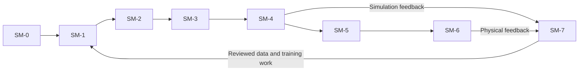

# SuperMimic Phase-by-Phase Delivery Plan

Status: in progress; data, physics, dynamics, actor/critic and a feedback round run.
Updated: 2026-10-23. Baseline: `22ef620c`.

Current priority: [method alignment](G1_SUPERMIMIC_ALIGNED_BASELINE.md), before
extending legacy CPU ablations. The real 40-clip LAFAN1 catalog and matching
robot assets are available; reward, action, relative termination, differentiable
survival, imagined GAE critic, adaptive reset, network-size profiles and full-clip
evaluation have a separate runnable provider. Its two-update smoke tests data
and learning integration, not control acceptance (40/40 motions fail). An exact
CPU split/resume test checks learner, Adam, replay, observation history and RNG.
Large-budget GPU training and the 129,514-motion benchmark remain unexecuted;
SM-0 through SM-7 are not marked complete by these changes.

This plan implements the [integration design](SUPERMIMIC_INTEGRATION.md).
The [data-slice guide](MOTION_LEARNING_DATA.md) records executable commands and
current limits. SM-1.1-SM-1.3 have partial implementation: schemas, numeric window
materialization, and source-family split checks. Real-robot data, broader modality normalization,
full dataset lineage, and full phase acceptance remain outstanding. Use `SM-`
identifiers to distinguish these phases from the main roadmap and MoonData's
pipeline phases. Owners below are responsibility roles, not assigned people.

The [G1 CPU physics guide](G1_CPU_PHYSICS.md) records the independent provider,
licensed model source, frozen procedural experiment, scoring and actual failed
control trials. SM-2.1-SM-2.3 have partial local implementation. These position
and unpowered controls are plumbing baselines. A [PPO baseline](G1_PPO_BASELINE.md)
now trains and is compared with model-based checkpoints on a shared physics
suite; its initial candidates still fall. The later sustained initializer below
now passes the bounded thirty-second suites. Broader learned control and a
matched efficiency comparison remain outstanding. The model/data implementation route
in SM-0 is partially resolved by that source inventory, not fully qualified.

The [G1 dynamics fit](G1_DYNAMICS.md) implements part of SM-3.1: noisy collection,
train-only normalization, an eight-step autoregressive residual model, held-out
scoring and frozen-model input-gradient verification. Three training seeds beat
persistence on this collection. This is local model-fitting progress, not a
completed SM-3 learning system. The subsequent [policy workflow](G1_POLICY_LEARNING.md)
implements local actor/critic updates, independent physics selection and
train-family recollection followed by dynamics refitting. Initial candidates
fail the control qualification. [Physical model diagnostics](G1_MODEL_DIAGNOSTICS.md)
and selected-weight warm starts now run; later survival improves to approximately
1.45-1.48 s, with no fall-free trials. The [experiment registry](LEARNING_EXPERIMENT_REGISTRY.md)
now stores reports, data and weights in MoonData and exposes a read-only host
API plus a cockpit comparison and failed-trial viewer. Continuous training,
matched PPO cost-to-target comparisons and the complete operator workbench
remain outstanding. SM-3.4 has a first final-quality comparison over three
training seeds per method, with different training histories explicitly retained.
A three-seed PPO action-range ablation also ran under fixed maximum budgets:
±0.3 rad candidates survive about 1.51–1.73 s on shared fresh conditions, with
all final trials still falling. Exploration amplitude and actual sample counts
change with the bound; no isolated action-capacity effect is claimed.

The [goal-coverage study](G1_GOAL_COVERAGE.md) adds independent per-episode pose
targets and 72 new training episodes, refits dynamics, and warm-starts three
model-based actors from PPO. One candidate passes the original and fresh
two-second suites but falls in every ten-second extension. It is registered
with both pass and failure evidence; the cockpit can switch evaluation scope.
Stable long-duration control and the full phase gates remain incomplete.

The [ten-second development study](G1_LONG_DURATION_STUDY.md) extends PPO and
collection beyond that cutoff, appends 24 failed episodes and refits with
explicit late-window sampling and scoring. Late prediction diagnostics pass
on sparse overlapping windows, but all three model-refined actors retain
update zero and fail all final trials. The registered `long-refinement` run
preserves the ten-second scope. This adds evidence, not a completed phase gate.

The [diagnostic ablations](G1_DIAGNOSTIC_ABLATIONS.md) exercise the planned
8/32-step actor-horizon and terminal-critic-value comparison over three seeds
per cell. All retain update zero. A measured horizontal-origin dependency is
then removed from dynamics; physical action-ascent probes improve and one
policy seed gains survival, but all candidates still fall. These experiments
are registered with their failures. SM-3.4's local ablation now has evidence;
stable quality, matched efficiency and complete phase acceptance remain open.

The [counterfactual study](G1_COUNTERFACTUAL_STUDY.md) adds 4306 actual physical
transitions from 108 pre-fall action branches and independently fixes measured
critic horizontal-origin dependence. All held-out arrays remain unchanged.
The 2×2 replay/model and critic-encoding comparison selects one updated seed,
but every final candidate still falls and that update worsens joint tracking.
Its four cells are registered. Physical return calibration remains an active
SM-3 research issue; no control or full phase gate is marked complete.

The [physics-return critic comparison](G1_PHYSICS_CRITIC.md) now grounds an
optional critic method in 180 fresh training-only physical episodes. Independent
value errors improve on paired physical trajectories, while all three actors
retain update zero and fail their final trials. MoonData preserves the complete
compressed training records as well as both methods' weights and traces. Correct
scalar values are not evidence of correct policy gradients or stable control;
SM-3 and the complete phase acceptance remain unfinished.

The [actor-update study](G1_ACTOR_UPDATE_STUDY.md) tests actual parameter
directions in restored closed-loop physics and compares learning rates with
earlier validation checkpoints. Recent-state sampling and smaller steps show
no consistent advantage. Seed zero selects updates 5/50 for standard/small
steps with longer survival but worse tracking; all final trials still fall.
Both methods are registered. The [short-cycle comparison](G1_SHORT_CYCLE_STUDY.md)
now recollects physical training episodes every five actor updates and optionally
updates a separate world model per seed. Actor/critic/model snapshots are selected
together. Only one adaptive seed gains survival with worse tracking; every final
trial still falls. This adds an executable alternation loop, not a completed
control or phase gate.

The [paired-gradient study](G1_PAIRED_GRADIENT_STUDY.md) now measures those
selected models against actual physical returns through fall. A seed's harmful
local direction improves when removing the critic boundary, but the follow-up
three-seed on/off training comparison with fixed model/critic selects update
zero throughout. Both methods retain failed trials in MoonData. This rules out
adopting that local result as an established stable-controller fix; successful
training-state coverage and basic balance remain active research work.

The [teacher-initialization study](G1_TEACHER_INITIALIZATION.md) now supplies
sustained physics states. A privileged handcrafted controller completes 9/9
canonical ten-second trials while retaining separate pose-goal failures.
Twenty-four teacher episodes include fifteen ten-second completions; subsequent
student-state labeling adds 360 train-only episodes. Supervised initialization
improves the best neural actor to six ten-second completions in nine final
trials, with all three wave trials still falling. No learned actor passes the
all-nine gate. This is baseline/data/initialization progress, separate from a
world-model policy improvement, matched efficiency or full phase acceptance.

The [sustained-model study](G1_SUSTAINED_MODEL_STUDY.md) now fits from all
648 original/teacher/student episodes through 32 native-validated source
chunks and verified compressed train shards. Original held-out arrays remain
unchanged. With the same actor replay and physical-critic supervision in both
cells, new-model refinement selects no updated actor. Common-scale global
prediction improves while sparse late prediction worsens. Both cells and
failed physical outcomes are registered. Learned control and full phase gates
remain incomplete.

The [temporal-input study](G1_TEMPORAL_INPUT_STUDY.md) now supplies causal
ten-observation histories, ten planned joint-goal previews and changing-goal
imagined rollouts. Three input variants use shared dynamic teacher conditions,
student-state supervision and subsequent actual frozen-model updates over
three training seeds each. One frame-only candidate completes seven of nine
ten-second trials, including one wave trial; no candidate passes all nine.
History/preview do not consistently improve control. The three model-refinement
cells register with their failed outcomes; supervised parents retain separate
research artifacts. This adds SM-3 evidence, without completing any phase gate
or establishing matched PPO efficiency.

The [dynamic-state gradient study](G1_TEMPORAL_GRADIENT_STUDY.md) now restores
causal history and changing-reference phase at 111 training origins, verifying
zero baseline trajectory error. Four of five nonzero selected parameter changes
reduce remaining physical return despite positive predicted changes; smaller
perturbations can differ from the full update. Open-loop dynamic prediction
error exceeds standing. The subsequent [dynamic refit](G1_DYNAMIC_REFIT_STUDY.md)
uses all 1332 temporal episodes, 390,235 actual transitions and 49,379 windows
without another giant merged export. Six equal-budget, frozen-normalization
old-only/mixed fits select updated models. Mixed replay improves dynamic H32
prediction but its fresh directions improve remaining physical return in only
8/18 model/actor combinations, versus 9/18 old-only. No new policy is selected.
The [temporal-value comparison](G1_TEMPORAL_VALUE_STUDY.md) now fits a finite-task
critic using state, causal history, planned reference and remaining time. Both
tail arms receive the same initial calibration and matched refresh budgets.
Independent value MAE improves 62–93%, but all 12 final actors fail qualification;
five of six tail-enabled actors retain update zero. Four failed cells and their
training/audit physics are registered. The [replay-distribution study](G1_REPLAY_DISTRIBUTION_STUDY.md)
now tests 108 frozen parameter directions and reconstructs three saved one-step
actors exactly. Teacher-only directions improve remaining return more often,
but its six subsequent full-training actors still fail every wave trial, with
four retaining update zero. Both failed training cells are registered. The subsequent
bounded SM-2/SM-3 comparison, [temporal PPO](G1_TEMPORAL_PPO_STUDY.md), now trains
from those same policy/value interfaces and incoming weights. Three seeds use
31,446 actual transitions and 84 actor steps across 270 failed training episodes;
none qualifies on the final nine trials. Prior model policies are re-scored
under the same fresh conditions. A separate 108-episode train-only noise
calibration finds both exploration sensitivity and poor initial train-family
coverage. The subsequent [disturbance initialization](G1_DISTURBANCE_INITIALIZATION.md)
compares clean/noisy student-state teacher labeling with the same 3000 updates
per seed and a broader fixed selection audit. All six final actors remain
unqualified despite more updated selections in the noisy arm. Its independent
small-noise training-family audit improves from 22/27 incoming falls to 13/27
disturbed versus 18/27 clean, while large-noise trials still all fall. It adds 432
actual training episodes, 110,140 transitions and independent noise audits.
The [balance intervention](G1_BALANCE_INTERVENTION.md) then freezes those actors
and probes eight joint/memory variants across 360 recorded episodes. Replacing
four ankle channels removes canonical diagnostic falls; removing teacher velocity
memory makes all canonical conditions fail, while ten error frames suffice for
that privileged teacher. Full teacher modes repeat six unique canonical physical
conditions across actor parents, so those repeats are not independent trials.
The subsequent [observation-derived balance features](G1_OBSERVATION_BALANCE_FEATURES.md)
verify exported differentiable FK on 512 poses and 34,953 recorded states.
Causal gyro/gravity transport approximates the teacher's filtered derivative,
with rare large errors preserved. In 81 new control episodes, derived fixed
ankle feedback closely matches privileged H10 feedback; both retain six falls
in 27 canonical actor-condition cells. No weights are fit or qualified. These
features support the subsequent [learned-feedback comparison](G1_LEARNED_BALANCE_FEEDBACK.md).
Two shared sixteen-coefficient heads fit only 54 train-role episodes (19,390
points), with parent weights frozen. Across 162 new physical episodes, full
causal memory completes all 27 canonical cells, H10 retains three falls, and
unchanged parents fall twelve times. Both learned variants still fail all nine
independent-joint-sine audit cells. This meets the observed small canonical
numeric threshold for three composite parents, not a full phase or release gate.
The [platform/duration study](G1_BALANCE_PLATFORM_AND_DURATION.md) then registers
four ten/thirty-second memory-arm records with exact labeled training exports.
All full-memory wave extensions fall after ten seconds, averaging 11.88 s;
stand/sway complete thirty seconds. The [long balance diagnosis](G1_LONG_BALANCE_DIAGNOSIS.md)
then records 86 channel/feature interventions: the original complete teacher
also fails. A predeclared eight-cell search on training families selects a
larger-range pose/rate teacher that completes all 36 fresh thirty-second
canonical/audit checks. No learned weights change in that teacher study. The
[sustained distillation](G1_SUSTAINED_BALANCE_DISTILLATION.md) subsequently fits
two shared representations on eighteen fresh train episodes and selects one of
five variants on separate training conditions. The selected four-ankle 0.45-rad
law completes all 54 thirty-second final learner cells. All 243 episodes pass
the native reader; recorded train data reproduce fifteen checkpoints exactly.
Three parent contexts share one law, so independent learning-seed, broader
reference/motion and release gates remain open. The subsequent
[full-body reference slice](G1_FULL_BODY_REFERENCE.md) supplies nine new successful
training-family clips, root/body motion and a 338-channel actor-goal representation.
Twenty-seven source-control reapplications reproduce every state component;
all twenty-seven reference-position baselines fall. Native validation covers
63 episodes / 42,095 actual transitions and independently recomputes state/joint
errors. A local per-trial quality target and common policy scoring callback are
defined before learned reference-tracker development. The subsequent
[reference initialization study](G1_REFERENCE_INITIALIZATION.md) adds the full-body
goal encoder and control mapping with learned relative feedback. Joint-input
supervision fails all three seed gates; the same fixed budget with the learned
observation decoder path masked during fitting passes all 81 final reference
coverage trials across three independent neural fits. Both studies retain their
108 physical episodes each; all 145,963 actual transitions validate natively.
The subsequent [reference platform integration](G1_REFERENCE_PLATFORM.md) registers
both new actor/data groups, including nine original motion clips and all108
numeric records per study, with their source/configuration/quality/native proof.
All six stored physics reports reopen through the existing API. The actual
cockpit now pairs by reference origin, labels remaining30/20/10-second scopes,
overlays the planned root trajectory through its full end and shows body/root
tracking errors. Whole-MoonData validation passes with zero findings. Full-body
3D and world-model overlays, skill release and the remaining phase gates stay
open. Because supervised
initialization already passes, incremental refinement to that target is zero
for both methods. A comparison from a shared nonpassing initialization, with
all priors and label access declared before training, remains possible. Matched
learning-cost evidence and full phase gates remain incomplete.

The [full-reference learning comparison](G1_REFERENCE_LEARNING_COMPARISON.md)
now implements that shared nonpassing-prior experiment, with declared inherited
feedback/normalization and no source-control actor labels. Both learners use
new own-policy physics, the same reference reward and a physical-return critic
with complete causal controller memory. Two frozen three-seed protocols collect
from 5/15/25 and 0/10/20 seconds respectively. All 666 episodes / 167,996
transitions pass native reading; imagined gradient checks pass. All twelve
final actors still fail the fixed 27-cell quality gate. Startup coverage alone
does not solve learning. Root integration consistency and meaningful training
coverage/budgets are next research targets. Cost-to-target is not reached;
these new studies are not yet registered, and no full phase is completed.

The subsequent [reference root integration diagnostic](G1_REFERENCE_ROOT_INTEGRATION.md)
fits paired models from identical first-collection data and initial tensors,
then tests both signs at two fixed parameter amplitudes. All 75 new episodes /
26,217 transitions pass native reading. Root H8 prediction improves across
three seeds, but the integrated positive directions reduce return in every
tested clip. Critic tails reverse otherwise negative prefix derivatives in
two seeds; another seed has an incorrect prefix sign too. This supports a
controlled prefix-only gradient test, not adopting root integration as a
successful learning fix. Matched successful quality/cost and full gates remain
open; no new study is registered or granted physical execution authority.

The [reference tail direction comparison](G1_REFERENCE_TAIL_DIRECTIONS.md)
then tests six new prefix-only directions against the existing with-tail
directions on identical models, priors and known physical reset conditions.
Only 72 episodes / 25,176 transitions are new; the paired 147-record report
explicitly reuses 75 older records. All pass native reading. Prefix-only
directions improve every model/seed mean at both fixed amplitudes, with nine
of nine individual full-return improvements for free models and eight for
integrated models. All trajectories still fall. Proceed to an actual training
ablation under the same quality gate; no policy-training or full phase
acceptance follows from this local direction result.

The subsequent [reference tail training comparison](G1_REFERENCE_TAIL_TRAINING.md)
now performs actual collection/refitting and 36 actor steps per method/seed,
mixing 0/10/20-second starts in every cycle and capping local logit RMS changes.
All 603 episodes / 141,351 transitions pass native reading; common first model/
value fits match exactly and both actor objectives pass gradient checks. All
six final actors still fall in all 27 cells. Prefix-only has mixed paired
survival results, so the useful local probe direction does not establish a
trained-controller improvement. Actor imagination still begins only at resets;
mid-trajectory actor coverage is a next test, not a demonstrated fix. New
experiments remain research artifacts pending platform registration. Successful
matched quality/cost, complete workbench and full phase gates remain open.

The [actor-state origin comparison](G1_REFERENCE_STATE_ORIGINS.md) now tests
that coverage hypothesis while reusing the verified reset baseline. Uniform
current-cycle transition sampling preserves causal history/EMA and phase, with
all 6,912 origin draws independently reconstructed. All three new seed means
improve; seed 2 completes three remaining-ten-second pose trials and passes two
individual quality cells, while its full 27-cell gate still fails. New physics
is 243 episodes / 66,414 transitions; the paired 603 / 152,776 report clearly
separates 360 inherited records. Native reading, exact shared first fits and a
mid-trajectory gradient check pass. The [learning platform slice](G1_REFERENCE_LEARNING_PLATFORM.md)
now registers both origin arms, preserving all 603 records and cycle weights.
The actual cockpit compares against the trained reset baseline and separates
individual quality passes, inaccurate completions and full-policy failures.
Sustained reference learning, full workbench, successful matched learning
efficiency and remaining phase gates remain unfinished.

The subsequent [reference duration comparison](G1_REFERENCE_EXTENDED_TRAINING.md)
continues the trajectory-state recipe to six cycles after deterministic replay
matches all three original actor/model/value checkpoints in every seed. Across
684 native-validated records /200,394 transitions (324 /104,169 new), two final
seed means improve to 12.004/10.219 s while the third regresses to 4.930 s. Five
individual seed-1 cells pass, including two twenty-second remainders; all full
policies fail. Its fixed initial-policy model diagnostic worsens in the
regressing seed. Test replay composition and physical update quality rather
than treating more training as a verified fix. Its six-cycle FIFO arm is now
included in the replay comparison's platform integration; the full duration
comparison has no separate entry. No full phase or physical authority is completed.

The [initial-anchor model-replay comparison](G1_REFERENCE_REPLAY_ANCHOR.md) now
tests a fixed retained early-data component without increasing the six-cycle
episode/update budget or fitting-pool capacity. All 927 episodes /284,781
transitions validate, with 324 /110,797 explicitly new. The new seed 1 policy
passes nine known pose cells, including three full 30 s trials, while its other
eighteen conditions fall. Other seeds show survival/accuracy tradeoffs; none
passes the full 27-cell gate. First-three-cycle weights and seeded model/actor
draws verify independently. Prediction MSE is not a sufficient control-quality
proxy. The [replay platform integration](G1_REFERENCE_REPLAY_PLATFORM.md) now
registers both six-cycle arms, all 927 paired records and cycle weights. The
cockpit uses the actual trained FIFO baseline and distinguishes full-duration
passes, inaccurate completions and falls. Inspect failed physical/model alignment
and retain all remaining phase requirements, including larger motion sources
and an unseen-motion evaluation set.

The [last-cycle alignment diagnostic](G1_REFERENCE_LAST_CYCLE.md) now compares
the actual saved cycle-5/6 actors under the frozen cycle-6 models, across both
replay arms, all three seeds and three representative reference starts. All
36 episodes /21,184 transitions validate; 18 /8,246 are new. H32 imagined change
matches actual H32 reward-change signs in only 8/18 cases, while full-return
signs match in 13/18 and have a different horizon. Five of six fixed training-state
samples gain imagined return. This supports measuring local physical action
responses before another budget increase, not a claim that model MSE, survival
or the finite saved update establishes accurate physical gradients. Complete
reference quality and all remaining phase requirements stay open.

The subsequent [local physical action-response study](G1_REFERENCE_ACTION_RESPONSE.md)
captures full solver snapshots at all 36 planned known states. All 324 records
/10,368 transitions validate, including 288 new counterfactual branches /9,216
transitions and 36 baseline replays. H8 positive first-control gradient directions
improve physical return in 36/36 states at both fixed amplitudes. H32 improves
27/36 and 32/36, with larger mean model than physical response. Local first-action
directions are therefore more reliable than the earlier complete saved policy
updates. Measure multi-step tape perturbations and feedback before choosing a
model refit or another actor-budget increase. No policy, motion coverage or
complete phase gate is qualified by this local diagnostic.

The [whole-tape/feedback comparison](G1_REFERENCE_FEEDBACK_RESPONSE.md) now
crosses both H32 direction sources with both execution modes at all 36 states.
All 648 archives /20,736 transitions validate, including 576 new perturbation
branches /18,432 transitions. Fixed-tape own directions improve 35/36 physical
states at both amplitudes; feedback own directions improve 26/36. Feedback
amplifies realized control changes and model response is overestimated. Two of
144 model derivative projections remain unverified at the smallest tested scale
and are retained explicitly. Test the backward observation/EMA path with an
unchanged forward controller next; no complete policy, phase or motion-library
requirement is satisfied by this diagnostic alone.

The [actor-gradient route study](G1_REFERENCE_GRADIENT_ROUTE.md) now checks
parameter directions with exactly equal forward objectives and origin batches.
All 162 episodes /74,888 transitions validate, with 144 /66,642 new. At the
larger positive step, anchor full-return gains rise from 3/9 to 9/9 when policy
input gradients are stopped; all still fall. FIFO has no uniform improvement
over full gradients. Test only the final training cycle's route next, replaying
saved actor operations/models to establish a matched starting state and evaluating
all 27 conditions for both methods and all seeds. This is not a completed
learning, policy quality, motion-library or full phase gate.

## Milestones And Dependencies

Development priority: get data -> physics -> learning -> comparison running.
Synthetic fixtures can support contract development before research inputs and
GPU resources are settled. Freeze scientific thresholds before comparisons,
but do not require production infrastructure to exercise the data path. General
checkpoint catalog extensions, exact restart recovery, retention/migration work,
and broad fault matrices move to the point where a real consumer needs them.
Keep split leakage, dimensions, units, episode boundaries, and physical authority
checks because they affect the meaning of the experiment or actual execution.

| Phase | Outcome | Prerequisites | Accountable role |
| --- | --- | --- | --- |
| SM-0 | Usable inputs and a frozen experiment charter | Design reviewed | Research / integration lead |
| SM-1 | Training-ready motion and transition data | SM-0 input and body decisions | MoonData maintainer |
| SM-2 | Physics collection and independent evaluation baseline | SM-1 | Simulation / evaluation engineer |
| SM-3 | Reproducible world-model and policy training experiment | SM-2 and a declared compute budget | Learning engineer / training provider |
| SM-4 | Inspectable, versioned motion-skill workbench | SM-3 evidence; UI development may use SM-2 fixtures | MoonRobo / Rabbita maintainer |
| SM-5 | E1 simulation and local-runtime compatibility | SM-4 and verified E1 interfaces/assets | E1 bridge / controls engineer |
| SM-6 | Bounded, operator-supervised physical qualification | SM-5 and existing physical authority/readiness gates | Hardware qualification owner / operator |
| SM-7 | Traceable feedback, retraining, and controlled expansion | SM-4 for simulation; SM-6 for physical feedback | MoonData / evaluation owner |

First research milestone: SM-0 through SM-3 on one body and flat ground.
First operator-facing release: SM-4, explicitly simulation-qualified.
First E1 physical release: SM-6, limited to named skills and operating bounds.
SM-7 closes the improvement loop; it does not authorize unattended deployment.

Plan work by these dependencies. Calendar estimates follow input availability,
an SM-2 throughput measurement, assigned owners, and a compute budget. The
paper's training time is not a project delivery estimate. A blocked dependency
holds only the dependent work; contract fixtures and evidence inspection can
continue when they do not require that dependency.

## SM-0: Inputs And Experiment Charter

Entry: the product boundary and simulation-first milestone are understood.

Tasks and deliverables:

- [ ] **SM-0.1** Record the implementation route: authorized upstream artifacts
  or independent implementation. Inventory code, weight, motion-data, and robot
  asset sources with their allowed research, redistribution, and commercial uses.
- [ ] **SM-0.2** Select one reference body, simulator version, motion source,
  initial skill set, and automatic differentiation runtime. Prefer G1 if usable
  assets are available to isolate algorithm validation from E1 adaptation;
  explicitly record any different choice and its effect on comparisons.
- [ ] **SM-0.3** Freeze an experiment charter with owners, hypotheses, baseline,
  data split policy, metrics, units, seeds, evaluation procedure, target quality,
  acceptable regression margins, compute/storage ceilings, and stop conditions.
  Use simulator-trained PPO as the default learning-efficiency baseline; a
  scripted controller is useful for plumbing checks but cannot establish a
  learning-speed comparison.

Exit evidence: a reviewed source inventory and versioned charter identify the
exact usable inputs and numeric acceptance criteria. Initial skills are bounded
flat-ground standing, walking, and turning; other skills require a new charter.
No input is inferred to be available merely because it appears in the Demo.

Hold: missing input rights or unavailable robot assets block dependent ingestion
or training. Unknown hardware or compute availability remains an explicit open
decision. Do not resolve it by extracting Demo assets or promising paper-level
performance.

## SM-1: Canonical Learning Data

Entry: SM-0 has selected usable assets, a body, and split/metric conventions.
Owners and likely touch points: `src/moondata_core`, `moondata_normalize`,
`moondata_quality`, `moondata_validate`, `moondata_publish`, and `cmd/moondata`.
These are integration locations, not commitments to add every type to one package.

Tasks and deliverables:

- [ ] **SM-1.1** Define versioned motion and transition schemas from the design,
  including joint/state layouts, units, clocks, coordinate/quaternion conventions,
  applied actions, context, reset, termination, truncation, and unavailable data.
- [ ] **SM-1.2** Materialize a small dataset into trainer-readable numeric arrays
  plus MoonData manifests. Add an actual loader, shape/dtype checks, checksums,
  and lineage. Preserve source bytes; retargeting/resampling creates new versions.
- [ ] **SM-1.3** Enforce split and quality rules: group related clips by source
  before splitting, fit normalization on training data, reject incompatible
  orders/units, and keep windows inside episodes and permitted continuous spans.
- [ ] **SM-1.4** Define checkpoint/policy/report artifact storage and registration
  using MoonData-owned payload refs. Reuse catalog rebuild and validation;
  extend their contracts only when concrete consumers require it. Retain
  compatibility with existing datasets/exports.

SM-1.4 has a first implementation through the existing source catalog and
BlobStore: two actual feedback runs register and pass payload validation.
Complete training lineage and specialized checkpoint/version contracts remain
partial. General retention, migration and recovery extensions stay deferred.

Exit evidence: a version can be loaded by the trainer and reconstructed for
replay with declared tolerances; importing the same inputs is idempotent. Tests
cover shuffled joints, wrong units, nonfinite values, missing actions, time gaps,
reset crossings, split leakage, corrupt payloads, and absent required state.
Catalog rebuild resolves all new artifact refs. Existing export consumers pass.

Hold: do not call an export training-ready while it contains only frame metadata
and payload URIs. Unknown physical quantities stay unknown rather than becoming
fabricated simulator state. Schema examples may proceed without GPU access.

## SM-2: Physics Collection And Evaluation Baseline

Entry: SM-1 data/loader checks pass and the experiment charter is frozen.
Owners: training provider for simulation; MoonData for batch registration;
evaluation engineer for independent scoring. The existing digital-trial importer
remains a result-binding surface, not the simulator implementation.

Tasks and deliverables:

- [ ] **SM-2.1** Implement a bounded simulator worker that resolves model/data
  versions, resets episodes, applies actions, records actual applied inputs and
  context, and seals transition batches into MoonData.
- [ ] **SM-2.2** Build a policy-independent evaluation harness with fixed tests,
  a simulator-trained PPO baseline, perturbations, failure/termination definitions,
  metrics, trial counts, and trace export. Match motions, observations, rewards,
  termination, randomization, policy capacity, and hardware for learning-cost
  comparisons. Score in the physics simulator, not only in a learned model.
- [ ] **SM-2.3** Produce reference/baseline replay and measured throughput/memory
  costs. Check coordinate alignment, timing, joints, contacts, and unavailable
  metrics against source evidence; freeze the comparison budget before SM-3.

Exit evidence: a baseline report and traces are reproducible on the declared
environment within stated tolerances; missing/corrupt/incomplete trials remain
visible. Distinct seeds, changed friction, malformed inputs, interrupted capture,
and duplicate import have exercised outcomes. Every aggregate has a denominator
and source trials. A fixture is labelled synthetic rather than physical evidence.

Hold: unresolved model/actuator configuration, untrustworthy scoring, or a
baseline that cannot be repeated blocks learning comparisons. Report failures
without redefining thresholds after viewing candidate results.

## SM-3: World-Model And Policy Learning

Entry: SM-2 provides valid transitions, an evaluator, and a matched baseline;
the declared resource budget is available.
Owners: learning engineer and training provider; MoonFlow handles job lifecycle.

Tasks and deliverables:

- [ ] **SM-3.1** Fit differentiable dynamics on autoregressive windows, with
  explicit state/observation/reward/termination treatment and simulator context.
  Validate multistep predictions on held-out simulator transitions.
- [ ] **SM-3.2** Implement the alternating collection/model-fit/policy-update
  loop, imagined return, critic, and correct termination/bootstrap masks.
  Start from the paper's fitting/horizon defaults only where compatible with
  the selected embodiment. Freeze world-model weights during policy updates
  while preserving gradients through predicted states and actions.
- [ ] **SM-3.3** Add typed provider job operations for submit/status/cancel/resume
  and checkpoints containing the state needed for the declared recovery mode.
  Reconcile duplicate submissions and unknown worker outcomes before launching
  another job. Keep in-memory replay and per-step execution local to the worker.
- [ ] **SM-3.4** Evaluate at least three declared training seeds with the SM-2
  harness. Compare cost-to-target and final quality against the matched baseline;
  inspect model-exploitation cases and include a critic/horizon ablation within
  the frozen budget. Save failed experiments and configuration changes.

Exit evidence: gradient checks show action/state sensitivity and no unintended
world-model parameter updates during policy improvement. Learning produces
finite, exportable candidates that meet the charter's quality/regression gates
in the physics simulator. Seed variation, failures, and complete cost accounting
are reported. An interrupted run resumes in its declared mode with a bounded
comparison against uninterrupted execution. Budget exhaustion produces a result,
not an unqualified success claim.

Hold: NaNs, privileged-input leakage, low model loss with poor simulator control,
or quality below the frozen target blocks promotion. A working but non-improving
method can remain a research artifact; revise the charter explicitly before
claiming a different objective. Do not claim a speedup unless measured at matched
quality. Passing quality alone may justify a workbench experiment, labelled with
the measured efficiency result.

## SM-4: Motion-Skill Workbench And Versioning

Entry: SM-3 candidates and evaluations exist. UI implementation may start earlier
with SM-2 fixtures, but the release gate requires real candidate evidence.
Touch points: MoonData artifact APIs, `src/host_api`, `src/cockpit`,
`src/desktop_host`, and `ui/rabbita-cockpit`.

Current slice: immutable experiment sources, per-seed candidate metrics,
payload/checkpoint references and `GET /api/moondata/learning-experiments` run
against actual failed candidates. The cockpit now compares selected candidates
and opens registered baseline/candidate height, upright and contact observations,
with case/seed pairing and a shared recorded-time cursor. Full compatibility,
reference/model tracks and review/adoption remain unimplemented; no SM-4 release
gate is satisfied yet.

Tasks and deliverables:

- [ ] **SM-4.1** Register immutable candidate versions with input/output schemas,
  body/model bindings, training provenance, evaluation refs, and retirement status.
  Keep integrity, simulation qualification, runtime compatibility, and physical
  authority as separate dimensions.
- [ ] **SM-4.2** Add an experiment workflow: select model/data, submit work,
  inspect progress, compare policies, review failed clips, and select a qualified
  simulation skill. Display reference, simulator, and world-model tracks with
  explicit origin and aligned timeline; missing tracks remain missing.
- [ ] **SM-4.3** Record review outcomes and data refs in RoboBook/MoonBook;
  propagate invalidated or stale evidence after a model/configuration change.
  Keep browser experiment output outside hardware actuation paths.

Exit evidence: an operator can trace a displayed metric to its trial, policy,
inputs, and payloads; reopen the experiment after restart; compare success and
failure; and see why a candidate is unavailable. UI/API checks cover stale refs,
missing evidence, duplicate requests, cancellation, and disabled physical actions.
The demo uses our authorized inputs, not extracted official Demo materials.

Hold: an aggregate-only dashboard, fabricated zero metrics, unresolved refs, or
a single ambiguous `ready` flag is insufficient for release. Keep candidates
inspectable while excluding them from qualified selection.

## SM-5: E1 Adaptation And Local Runtime

Entry: SM-4 is usable, and E1 model/configuration and supported device interfaces
are available. Hardware control permissions are not implied by this phase.
Owners: E1 controls/bridge engineer; learning engineer for target adaptation.

Tasks and deliverables:

- [ ] **SM-5.1** Establish E1's model, inertial/contact/actuator parameters,
  joint ordering, estimator, calibration, timing, and retargeting. Create an E1
  dataset and simulation version; train or adapt and re-evaluate on that body.
- [ ] **SM-5.2** Implement a local policy runner and a declared bridge capability
  for bounded skill requests. Validate weights, observations/history, previous
  action initialization, goal interface, normalization, setpoints, and gains.
  Do not route joint outputs through the existing WALK/RUN outbox.
- [ ] **SM-5.3** Exercise inference using recorded telemetry, simulation, and a
  device stub. Measure latency/jitter against the target control deadline.
  Test stale input, overruns, malformed output, process failure, disconnect,
  stop, takeover, and exclusive device-control ownership without physical motion.

Exit evidence: target-specific simulation meets its predeclared gates; exported
runtime actions agree with the training implementation within declared numeric
tolerances. Compatibility reports bind exact model, firmware/interface,
calibration, policy, control period, and actuator configuration. A dry-run runner
cannot write to hardware; fault exercises expose a deterministic stop/reject
outcome and retain evidence. Device stop semantics are verified as supported.

Hold: missing low-level control support, calibration, deadline compliance, or
stop semantics leaves E1 deployment unavailable. Simulation remains available;
do not transfer G1 qualification or reinterpret a high-control bridge as an
already qualified learned-policy runner.

## SM-6: Bounded Physical Qualification

Entry: SM-5 evidence passes, with named hardware, firmware, operator, environment,
allowed skills, initial conditions, current readiness/calibration, and the
separate authority envelope required by the product contract.
Owners: hardware qualification owner and operator; MoonRobo owns dispatch.

Tasks and deliverables:

- [ ] **SM-6.1** Freeze the physical test matrix, numeric limits, abort criteria,
  duration, stop/takeover procedure, and recovery behavior. Bind authority to the
  exact skill digest, body, session, and requested goal range.
- [ ] **SM-6.2** Execute staged supervised trials within that matrix, beginning
  with the lowest-energy qualified behavior. Capture telemetry, actual actions,
  interventions, command identity, receipts, and simulator-to-real residuals.
- [ ] **SM-6.3** Exercise stop, stale telemetry, reconnect, process restart,
  duplicate command, lost acknowledgement, and unknown outcome. Reconcile against
  device state before retry. Verify candidate deactivation and safe recovery
  without automatic in-motion policy replacement.

Exit evidence: named physical reports meet the frozen task and negative-path
criteria and bind telemetry to actual dispatch. Any qualification names its
operating bounds; no data/model or simulator report can grant physical authority.
Missing feedback remains unknown, even if a command was acknowledged.

Hold: a failed stop/takeover test, unresolved command outcome, stale binding, or
limit violation blocks further candidate trials until resolved and requalified.
Revocation prevents new starts. Recovery follows the verified device-specific
procedure, never an automatic motion retry.

## SM-7: Feedback And Controlled Expansion

Entry: SM-4 supplies an operational simulation lifecycle; physical inputs also
require SM-6. Owners: MoonData, evaluation, and MoonBook integration maintainers.

Tasks and deliverables:

- [ ] **SM-7.1** Link failures and interventions to exact skill/data/body versions.
  Publish bounded diagnosis and recollection work from accepted outcomes; retain
  missing-state and estimated-value labels in real telemetry.
- [ ] **SM-7.2** Demonstrate one complete improvement cycle: failure review,
  selected new data, derived dataset version, new training run, fixed-set
  regression evaluation, and a separately qualified candidate. Protect the
  held-out test set from recollection and repeated tuning leakage.
- [ ] **SM-7.3** Increase motion-library size in measured steps on the same body.
  Track compute-to-target, prediction error, per-motion quality, replay/storage
  pressure, and regression coverage. Propose separate studies for terrain,
  objects, new embodiments, or using real data to refine dynamics.

Exit evidence: the complete improvement chain is traversable in both directions;
the candidate's improvements and regressions are measured on fixed evaluation
versions. Adoption is explicit, old results remain inspectable, and any physical
use passes compatibility and authority gates again. A larger library has its own
measured cost/quality results, rather than an assumed paper scaling law.

Hold: uncertain data provenance, new distribution outside the charter, test-set
contamination, or worsened required behavior blocks promotion. Accepted lessons
may request new work but cannot activate an unreviewed controller.

## Evidence And Status Rules

Each phase completion record must contain the phase/task IDs, code revision,
configuration and input digests, owner/reviewer, validation commands, output
artifact refs, metric results, limitations, and remaining blockers. Store durable
data in MoonData and work/review state with its existing owner. A completion
record is a reference bundle, not another raw-data store.

Freeze numeric thresholds and compute ceilings before the dependent experiment;
an unset required threshold means not ready. Record pass, fail, blocked, and not
run separately. A failed scientific hypothesis is a valid research result, but
does not satisfy a release gate requiring improved or non-regressing behavior.

For MoonBit changes, run `moon check`, focused `moon test` coverage, and required
project checks. Finish with `moon info` and `moon fmt`, reviewing `.mbti` changes.
Use `.mbtx` for agent-authored automation. Run provider numerical/gradient tests
and UI/bridge checks when those boundaries change. Digital tests cannot qualify
hardware; hardware evidence must identify the exact platform and conditions.

## Initial Work Queue And Open Decisions

Start in this order, keeping each change independently reviewable:

1. **Inputs and charter (SM-0.1-SM-0.3):** resolve implementation rights, select
   the body/data/runtime, assign owners, and freeze metrics and resource limits.
2. **Data slice (SM-1.1-SM-1.3):** one usable motion collection, concrete aligned
   arrays, actual trainer reader, and positive/negative validation fixtures.
3. **Simulation evidence (SM-1.4, SM-2.1-SM-2.3):** artifact registration,
   bounded collection, baseline evaluation, and reference-versus-actual replay.
4. **Learning loop (SM-3.1-SM-3.4):** dynamics, policy/critic optimization,
   recovery, and measured comparison before expanding to the workbench.

Unresolved decisions at plan creation: authorized implementation/data source;
reference body and simulator/runtime versions; assigned people; available GPU
and storage budget; numerical acceptance thresholds; and E1 device-local
control/stop interfaces. These are implementation dependencies, not missing
sections of this plan. No infrastructure purchase, upstream contact, training
launch, or physical operation is performed by publishing this document.
