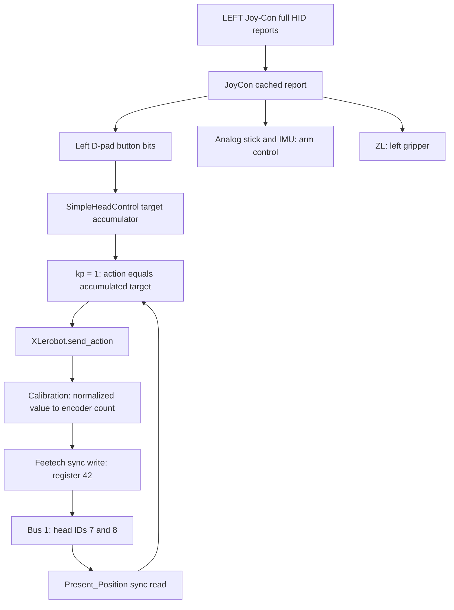

# Installed XLeRobot reference study — 2026-11-25

The installed source has been traced from Joy-Con reports through head targets,
calibration conversion, Feetech packets and robot shutdown. It is **not behaviorally
equivalent** to the current MoonBit neck controller. The important differences are
input selection, target size, timing, startup pose, inherited servo settings and
fault policy. This study made no actuator writes and did not run a legacy entrypoint.

The current neck session is stopped. Visible motion and physical direction remain
unqualified. The latest velocity fault is retained; nothing here authorizes clearing
it, increasing a limit or replaying the old startup sequence.

## Source identity and scope

The runtime reference is the software on `elf@192.168.2.192`, rather than today's
[upstream XLeRobot](https://github.com/Vector-Wangel/XLeRobot). Upstream documentation
provides project context; the following installed files establish this setup's behavior.

| Source | Revision / qualification |
| --- | --- |
| `/home/elf/lerobot` | `d57d1aa1970eec7b102a9527262ede4a3dd7a726`, Seeed-Projects/lerobot origin; copied XLeRobot files are untracked |
| `/home/elf/XLeRobot` | `6670d7db14adca0fab167bb569f160d7ba4672ec`, `https://gitee.com/jiaanguo/XLeRobot.git`; historical software inspected from git HEAD because files were moved out of its working tree |
| `/home/elf/joycon-robotics` | `f1b8d2f3ce1a0d0b472f150ca8d6b359f619f66f`, locally modified editable package; installed files, not pristine HEAD, inspected |
| Feetech SDK | Installed `scservo_sdk` under `/home/elf/miniconda3/envs/lerobot/lib/python3.10/site-packages/` |
| Motor calibration | `/home/elf/.cache/huggingface/lerobot/calibration/robots/xlerobot/my_xlerobot.json` |

The installed `xlerobot.py` matches the archived mirror byte for byte. The regular
Joy-Con example differs only in logging comments and its final newline. The regular
example is present and imports the installed `xlerobot` package. The smooth example
imports `xlerobot_2wheels`, which is absent from the installed robot packages. No
launcher was found that proves which example the operator historically used. Code
availability is not proof that every variant ran on this robot.

Read-only source copies are in `_build/xlerobot-study/` and
`_build/neck-control-elf/legacy-*`. The retained
[source manifest](evidence/xlerobot-reference-20261125.json) records hashes and original
paths; ignored build copies are a local inspection cache, not a permanent vendor tree.
The study covers regular and smooth Joy-Con examples, keyboard/Xbox/VR alternatives,
both robot variants, arm IK, camera/network paths, Joy-Con library, motor bus, SDK,
saved calibration and our actual trial audits. It does not claim hardware qualification
of arms, base, VR, or every upstream revision.

## End-to-end path and bus ownership



Two independent serial buses run at 1 Mbaud. Bus 1 contains left arm IDs 1–6
and head IDs 7–8. Bus 2 contains right arm IDs 1–6 and three omniwheel IDs 7–9.
Repeated IDs on different buses are intentional. The archived two-wheel variant
uses wheel IDs 9–10 on bus 2; it does not move the head to that bus. Default serial
names `/dev/ttyACM0` and `/dev/ttyACM1` are not reliable identities after USB changes.
Our transferred neck uses only its commissioned adapter and IDs 7–8.

## Exact head input semantics

The regular example's `SimpleHeadControl` is at lines 280–325. Executable
assignments, rather than the contradictory adjacent comments, establish:

| Left Joy-Con input | Target change per main-loop iteration |
| --- | --- |
| D-pad up | `head_motor_2` / ID 8: +2 |
| D-pad down | ID 8: −2 |
| D-pad left | `head_motor_1` / ID 7: +2 |
| D-pad right | ID 7: −2 |
| Thumbstick / moving the whole controller | Arm inputs, not this head path |
| ZL | Gripper input, not a neck deadman |

The current MoonBit interface deliberately uses the thumbstick with ZL as a
deadman. Its provisional right→ID 7 positive and down→ID 8 positive mapping is
opposite the old D-pad signs for those logical directions. This is an interface
difference, not sufficient evidence to flip physical signs: the mount was transferred,
and scene motion in an image can be opposite actual camera rotation. Qualify physical
direction by watching the bracket relative to the torso.

`kp=1` computes `current + (target - current)`, exactly the accumulated target.
It does not provide a software trajectory ramp. The smooth two-wheel example
smooths other parts of teleoperation but retains this incremental head controller.

## Units: the variable named degree_step is misleading

`XLerobotConfig.use_degrees` defaults to **false** (config line 66). The example
constructs `XLerobotConfig(id="my_xlerobot")` without overriding it (line 423).
Consequently the head uses `RANGE_M100_100`, not degrees. With drive mode zero:

```text
normalized = (clamp(raw, min, max) - min) / (max - min) * 200 - 100
raw = int((clamp(normalized, -100, 100) + 100) / 200 * (max - min) + min)
```

The motor bus implements these formulas at lines 770–827. The saved head calibration is:

| Motor | Homing offset | Range | Normalized zero → raw | +2 normalized → count delta |
| --- | --- | --- | --- | --- |
| ID 7 | −1900 | 933–3043 | 1988 | 21.10 before integer conversion |
| ID 8 | 1882 | 1040–3204 | 2122 | 21.64 before integer conversion |

Both drive modes are zero. A +2 increment therefore usually produces **21 or
22 encoder ticks**, approximately 1.85° or 1.90°, depending on axis and rounding.
It is not exactly 2°. One tick is approximately 0.0879°.

Even the optional DEGREES conversion uses the calibrated range midpoint and
4095 as its scale denominator; it does not make raw 2048 a universal neutral.
The old normalized-zero goals 1988/2122 are outside our current commissioned
bounds 1870–1984 / 1990–2104. Never reuse that startup zero on the E1.

The direct example declares `FPS=30` and imports `busy_wait`, but calls neither
`busy_wait` nor a sleep/rate limiter in its main loop. Its actual rate is I/O limited
and unmeasured. Thus neither 30 Hz nor a 60°/s target rate is established by that
constant. The ZMQ host is a separate path and does enforce its configured loop period.

Our current maximum is one tick per at least 50 ms, or 20 target ticks/s. This
differs substantially from roughly 21–22 ticks per unpaced old iteration. A target
slew bound is not a guarantee of instantaneous physical shaft speed.

## Startup, calibration and shutdown

1. `connect()` opens and handshakes both full robot buses. It offers saved calibration
   restoration or manual calibration; this is not a neck-only inspection command.
2. Restoration writes homing offset and min/max limits to each motor, then caches
   the calibration. It is not merely loading a host-side JSON transform.
3. Cameras connect, then `configure()` disables torque on both buses. Feetech torque
   disable also unlocks EEPROM; enable writes torque on and locks it again.
4. In this snapshot `configure()` calls **bus2.configure_motors() twice** and omits
   bus 1. It explicitly sets head position mode and hardware PID P/I/D=16/0/43,
   then enables both buses. Therefore generic Feetech acceleration defaults cannot
   be assumed to have been applied to the head.
5. The example reads current observations, creates controllers, then explicitly
   moves both arms and head to normalized zero. A later reset button repeats that
   zeroing. Initializing targets from feedback does not make this startup hold still.
6. The example's `finally` calls `joycon_right.disconnect()`, then left and robot.
   The installed outer `JoyconRobotics` defines **`disconnnect`**, with an extra n,
   rather than `disconnect`. Its inner wrapper's disconnect alias does not supply
   that missing outer method. Static inspection therefore finds a path that can
   raise before robot cleanup runs.
7. If reached, `robot.disconnect()` stops the base and disconnects buses; the bus
   default disables torque on all joints before closing. Loaded neck joints can
   fall when released. This cleanup is not copied into the new controller.

The incident's initial SRAM capture had torque 0, acceleration 0, goal 0,
goal time 0, speed 0 and torque limit 1000. That is a concrete historical capture,
not proof of the settings used during the last successful old teleoperation.
The later dangerous saved-block restoration is documented in
[the neck incident/runbook](E1_NECK_CONTROL.md). No saved SRAM block may be restored.

## Motor commands and inherited settings

The old head action path writes `Goal_Position` only. It does not explicitly set
goal speed 20 or 50 on each head action. Its actual speed and acceleration therefore
depend on configuration and inherited motor state, which must be measured rather
than inferred from the name of a helper elsewhere in the code.

Feetech normalization precedes sign encoding and low-byte-first serialization.
Goal writes use broadcast Sync Write (instruction `0x83`), register 42, two bytes per
motor. The SDK's `syncWriteTxOnly` reports host transmission status, not an individual
servo ACK. Observations read head position; the old head loop does not enforce our
feedback velocity, load, current, temperature, freshness or persistent fault policy.

The current MoonBit path uses acknowledged writes, fresh full feedback, one-tick
targets, audit persistence and an expiring execution gate. Those checks intentionally
add work to the loop. Its 37 passing regressions validate policies and packet handling;
the simulator immediately copies goals into position with velocity zero and does not
model stiction, backlash, motor deadband or quantized velocity feedback.

Measured phase is 12 and factory bytes 80–86 are `[1,20,50,1,65,50,1]` on both
motors. The vendor describes fine speed units and a physical minimum increment of
50 fine units, about 4.4°/s; fine values 1–49 do not create a smaller physical speed
increment. See [FEETECH's STS memory table](https://ftservo.github.io/ftservo-wiki/reference/parameter/memory-sts/).
This explains why setting 20 was unsuitable, but **does not prove it was the sole
cause of the failed visible-motion tests**. Profile 50 also produced a velocity fault.

## Joy-Con library and Bluetooth evidence

The installed outer controller opens three HID objects: plain `JoyCon`,
`GyroTrackingJoyCon` and `ButtonEventJoyCon`. They keep reader handles alive, initialize
IMU/full `0x30` reporting, and cache full reports. The low-level constructor passes
`serial=None` to device open even when discovery returned a serial, so it can select
the first matching VID/PID. The local package patches the accepted serial prefix;
the archived library is not an interchangeable runtime reference.

The example's FixedAxes subclass hardcodes left stick centers horizontal 2000,
vertical 2300 and thresholds 300. Stick SPI calibration loading is commented out in
the low-level reader. IMU calibration/reset is separate from motor neutral calibration.

The solver runs about every 10 ms and `get_control()` returns cached results.
The old head loop has no packet-age deadman: repeated output or a live Python
solver is not evidence of fresh Bluetooth packets. Runtime solver exceptions log
and retry after a second. That behavior can conceal transport stalls and cannot
serve as the new neck's disconnect policy.

Our UHID path passed one finite five-minute input-only recording, then later
connections again stopped producing reports despite BlueZ saying connected. A
temporary input-only evdev holder was also tried; it did not establish a permanent
fix and no keeper service was installed. Source inspection alone does not prove
the old triple-handle arrangement fixes Bluetooth. Preserve MAC identity and raw
report freshness checks; never reconnect physical actuation automatically.

## Arms, base, camera and alternative inputs

| Subsystem | What this snapshot does | Relevance to the transferred neck |
| --- | --- | --- |
| Arms | Fixed-axis Joy-Con translation/orientation; two-link SO101 IK with lengths 0.1159 m and 0.1350 m, geometry offsets and workspace clamping; separate gripper input | Whole-controller motion belongs here. IK emits degree-like joint values while the robot defaults to normalized units; callers need an explicit unit contract |
| Three-wheel base | Body X/Y/yaw transformed to three omniwheel velocities on bus 2; selectable speed multipliers | Wheel velocity semantics must not be applied to head position mode |
| Two-wheel variant | Differential drive, wheel radius 0.05 m and track 0.25 m; separate robot package | Its smooth arm/base behavior is not neck trajectory smoothing |
| Keyboard / Xbox | Alternative per-joint/incremental teleoperation; Xbox head button increments use the same style | A different device does not establish motor speed limits |
| VR | Separate controller metadata/thumbstick path and incremental head targets | Joy-Con sign/mapping assumptions do not transfer automatically |
| Cameras | Optional OpenCV/RealSense configs, observation calls `async_read()`; actual default camera entries are all commented out | Old default teleoperation does not itself prove an active camera stream |
| ZMQ | Command PULL 5555, observation PUSH 5556, latest-message conflation; JPEG quality 90 and base64 images in JSON | Separate network path, not used by the direct Joy-Con loop |
| Network watchdog | After 500 ms without commands, host calls `stop_base()` | This stops wheels, not a safety-qualified neck session |

## Actual MoonBit trial results and remaining diagnosis

The [updated physical evidence](evidence/e1-neck-physical-trials-20261125.json) records
four trials. Both profile-1 trials failed visible qualification. The operator then
approved speed 50 with the existing ±5° envelope, torque 300 and velocity guard 60.

Profile-2 trial 1 completed holding after about 24 seconds, consistent with Minus
ending the session early. Pan feedback changed 1898→1908; the operator saw no visible
motion. A subsequent requested five-second hold happened after that session had
ended and is not valid movement-test evidence. That timing mistake was acknowledged.

Profile-2 trial 2 ended after about 15 seconds at pan velocity +100, before the
requested hold could finish. At its last two pan feedback samples:

| Monotonic capture ms | Position | Goal | Raw velocity |
| --- | --- | --- | --- |
| 10214192 | 1918 | 1923 | 0 |
| 10214254 | 1920 | 1924 | 100 |

The last raw reply contains little-endian velocity bytes `64 00`, so +100 is not
a sign-decoding mistake. Position changed two ticks in 62 ms; that sampled average
does not equal the motor's instantaneous velocity register. A short internal velocity
pulse or quantization is plausible, **not established harmless**. The unchanged guard
60 correctly stopped execution under its current policy, with no later write record.
The operator again reported that the bracket stayed still. Encoder counts do not
establish secure horn/bracket coupling or correct visible camera motion.

The existing evidence supports several unresolved contributors: much smaller
targets, servo deadband/stiction and inherited profile differences, a raw-velocity
guard that faults on actual feedback, early session termination, and possible
mechanical coupling. It does not isolate one root cause or prove the motor is broken.

The next implementation work should replay retained hardware telemetry against a
realistic motor model, make units and session state explicit, and separate transport,
target, shaft feedback and bracket observation in diagnostics. A D-pad compatibility
mode can reproduce old logical input signs while retaining bounded targets. Any
change to velocity policy needs evidence and review; do not silently increase 60.
Keep checked startup, fresh feedback, deadman, bounded deltas, durable faults,
one-use receipts and write-before-send audit. Never copy whole-robot startup zeroing,
cached-input continuation, blind broadcast success assumptions or torque cleanup.
