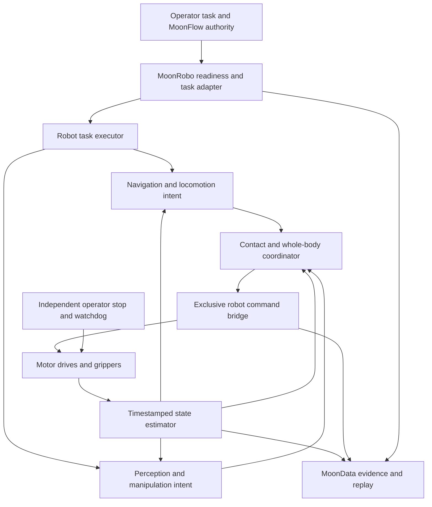

# Vectie T1: engineering specification V0

Date: 2026-10-29. Status: proposed system requirements for design review.
Companion documents: [resource audit](RESOURCE_AUDIT.md),
[development plan](DEVELOPMENT_PLAN.md).

## 1. Product objective and operating envelope

Deliver Vectie T1 as a repeatable robot system, including its hardware, calibration, control,
perception, task execution, operator tools, data, service procedure and verification
record. The user's priority is walking first, followed by manipulation and complete
tasks. There is no fixed budget, team or delivery date yet.

The product name is **Vectie T1**, with canonical model identifier `vectie-t1`.
Hardware revision, serial number and specification revision are separate identities.
MoonRobo supplies the robot software and governed operation boundary.

V0's complete task is:

1. Accept a bounded operator-authorized task and identify one of five known objects.
2. Navigate a mapped indoor route to a work station.
3. Stop, establish stable double support, and verify the grasp workspace.
4. Grasp, verify retention, and return the arms to a qualified carrying pose.
5. Walk to the destination with the payload, stop, place, verify release and retreat.
6. Return to standby and save the result, including interventions and failures.

An empty grasp permits one bounded re-observation/retry when the workspace remains
valid. A dropped object, unknown robot state or obstacle inside the exclusion area
requires the qualified stop/recovery path. The task supervisor must reconcile an
uncertain outcome before retrying a physical action.

**Proposed V0 operating envelope:** supervised research facility; dry, level,
measured hard flooring; 15–30 °C; defined lighting and camera visibility; mapped
routes; no stairs, public access or unattended charging. Five rigid, opaque,
nonhazardous objects of 0.2–1.0 kg, with gripping features compatible with the chosen
grippers. Tables are initially 0.65–0.85 m high. Route width, measured floor friction,
lighting limits, obstacle clearance and operator exclusion distances must be frozen
from the actual facility before physical acceptance. They are open design inputs.

Later releases may add uneven terrain, stairs, recovery from the floor, dexterous
hands and more general objects. These require additional requirements and evidence;
V0 remains a complete system within its declared envelope.

## 2. System requirements

All numeric performance values below are **proposed**, not measured capabilities.
The named verification tests are defined in section 10. Safety-related timing and
limits require hazard analysis before a hardware release.

| ID | Requirement | Verification |
| --- | --- | --- |
| R01 | 28 independently modeled body joints: legs 6×2, waist 2, arms 7×2; two additional gripper channels. Fixed head/sensor mount in V0. | T01 |
| R02 | Standing height 1.30–1.40 m; total operating mass ≤40 kg, including compute, battery and grippers, excluding payload. | T01 |
| R03 | Unloaded straight walking at a commanded 0.6 m/s; turning, start/stop and reverse commands within a separately qualified envelope. | T06 |
| R04 | Carry up to 2 kg total near the torso at ≤0.3 m/s; individual objects ≤1 kg. Payload pose and center-of-mass envelope are part of the controller profile. | T08 |
| R05 | Each arm holds 1 kg for 60 s with the payload center 0.35 m horizontally from the shoulder in qualified double support; achieve the station workspace without joint-limit or balance violations. | T07 |
| R06 | Complete at least 90 of 100 declared mobile manipulation trials, with zero falls or prohibited contacts. Retain all failures and interventions in the denominator. | T08 |
| R07 | Operate for ≥60 min on the defined duty cycle: 40% walking, 30% stationary manipulation, 30% standing/standby, with perception and logging enabled. | T09 |
| R08 | Target a 500 Hz robot bridge/state loop and 50 Hz locomotion actor; actor inference p99 ≤10 ms under concurrent perception and thermal load. No policy evaluation may block the independent watchdog. | T04 |
| R09 | Reject stale, malformed, incompatible and duplicate/expired commands; use a single active actuator command owner. Proposed stale-command detection bound ≤20 ms from expiry, subject to the stop analysis. | T05 |
| R10 | Provide an independent stop/watchdog path, physical operator stop, controlled access and qualified behavior for power loss, communication loss and drive faults. No PL/SIL claim is made by this specification. | T05 |
| R11 | Joint state, IMU, foot contact/load information, front depth/RGB and two wrist image streams have timestamps, frame identities and measured uncertainty. | T03 |
| R12 | Every robot, simulator, experiment and 3D replay binds the same robot package revision; foreign robot trajectories cannot silently render as our robot. | T01, T11 |
| R13 | Deploy only compatible, hashed inference artifacts and their normalization/estimator configuration. Training and world-model optimization run offboard. | T10 |
| R14 | Stationary arm control and walking have explicit ownership/contact transitions; manipulation cannot overwrite a leg controller or bypass whole-body constraints. | T07, T08 |
| R15 | Boot, restart, reconnect and software update leave actuation disarmed until identity, readiness and authority checks pass; do not automatically replay the last action. | T05, T12 |
| R16 | Record task, policy, calibration, sensor, command, fault and intervention evidence with detectable drops and clock discontinuities; replay can distinguish reference, simulation and physical data. | T11 |
| R17 | Build three pilot units from one released package, each passing calibration, end-of-line checks and the required acceptance suites without undocumented per-unit code changes. | T12 |
| R18 | Maintain a per-component software/model/data/hardware provenance and license inventory before external distribution. | T13 |
| R19 | Operator UI uses one language at a time, persistent light/dark choice and one robot context across Experiment → Results → Replay; physical readiness stays distinct from smoke results. | T11 |
| R20 | A released design includes serviceable modules, connector labeling, fastener specifications, calibration instructions, failure diagnostics, packing and transport procedures. | T12, T13 |

## 3. Body and mechanical design

### 3.1 Kinematic proposal

| Assembly | Proposed logical joints | Count | Design decision |
| --- | --- | ---: | --- |
| Left/right legs | hip yaw, hip roll, hip pitch, knee pitch, ankle pitch, ankle roll | 12 | Six logical axes each; evaluate RP1 ankle linkage after load/kinematic analysis |
| Waist | yaw, roll | 2 | Preserve the chosen two-axis architecture consistently; pitch would be a new revision |
| Left/right arms | shoulder pitch/roll/yaw, elbow pitch, forearm rotation, wrist pitch/yaw | 14 | Seven axes each; actual order and axis transforms frozen with CAD |
| Hands | one opening command per gripper | 2 channels | Parallel grippers initially; opening width, force and feedback selected against the object set |
| Head | fixed sensor mount | 0 | Leave mechanical/electrical provision for a later pan/tilt variant |

This defines 28 **body DoF**, plus two gripper commands. Motor count and logical
joint count must be distinct fields. A coupled ankle requires a linkage mapping;
gripper internal joints need not equal the number of controlled channels. Do not
reuse RP1, E1 or G1 index order implicitly. G1's 29-body-joint model is a separate
embodiment, not a compatible checkpoint target.

Freeze the following before machining load-bearing parts: joint axes/origins/ranges,
hard and software stops, link masses/inertias, foot dimensions/compliance, bearing
loads, shaft/linkage stresses, fasteners and preload, cable bend radii, tool access,
service points, pinch protection and a rated lifting interface. Check the complete
pose workspace for self-collision and cable damage. Mechanical limits must remain
independent of learned policy outputs.

### 3.2 Initial mass allocation

This is a design budget to close against a real BOM, not a weight estimate from RP1.

| Group | Allocation, kg |
| --- | ---: |
| 28 body actuator modules | 20.0 |
| Structure, feet, covers and bearings outside modules | 6.0 |
| Compute, control electronics and cooling | 2.5 |
| Battery, BMS and enclosure | 4.5 |
| Two grippers | 1.0 |
| Sensors | 0.5 |
| Harness, power distribution and connectors | 1.5 |
| Unallocated mass reserve | 4.0 |
| **Total limit** | **40.0** |

If selected modules consume the reserve, revise the geometry/actuator choice or
formally change R02. Do not keep a 40 kg simulator while building a heavier robot.

### 3.3 Actuator selection

Purchase proven modules for the first version. ROMOMO is a candidate source:
its published table gives RMM10062-2E at 44 N·m rated/160 N·m peak and RMM6562-2E
at 10/35 N·m, both in the 48 V class. These are publisher specifications;
our continuous duty and peak-duration qualification remain open.
See [ROMOMO documentation](https://github.com/Roboparty/ROMOMO).

Select each joint from inverse dynamics of standing, starts/stops, single support,
qualified arm reaches and loaded walking. Include transmission efficiency, reflected
inertia, acceleration, shock, temperature and low battery voltage. Proposed sizing
screen: available continuous torque ≥1.3× trajectory RMS demand and allowed peak
torque ≥1.5× trajectory peak, with speed and duration inside the measured envelope.
These are screening margins, not structural safety factors or proof of adequacy.

For scale only, a 40 kg body with a 0.15 m horizontal support lever produces
`40 × 9.81 × 0.15 = 58.9 N·m`. Load sharing and dynamics determine which joint
sees that moment. A peak torque headline cannot close this calculation.

The actuator dossier must contain torque/speed/voltage/temperature curves,
continuous and transient ratings, braking/regeneration behavior, efficiency,
backlash, encoder resolution/repeatability, current-to-torque characterization,
mass/inertia, drive protocol/firmware, fault behavior, supply and service terms.

## 4. Electrical, compute and sensing

### 4.1 Power

Use a 48 V-class actuator architecture as the initial candidate. Actual cell count,
full-charge voltage, cutoff voltage, current capacity, precharge, contactor, fuses,
cable sizing and charger must be co-designed with the drives. Include regenerative
energy and behavior when a charged battery cannot absorb it. Keep control/stop
electronics powered long enough to record and execute the qualified fault response.

Proposed starting energy budget: 600 Wh nominal with 80% usable energy. At a measured
450 W average system load this gives `600 × 0.8 / 450 = 1.067 h`, or 64 min.
Neither 450 W nor the battery mass is validated. R07 is accepted by measurement
over the defined cycle, including conversions, cooling and low-voltage reserve.
Peak currents are sized separately from average energy.

V0 uses a removable, externally charged battery. Hot swap is optional future work;
the existence of an RP1 hot-swap PCB does not qualify our integration. Require
supplier cell/pack traceability, BMS fault data, test reports, transport documentation
and a compatible charger. The complete robot needs its own electrical review.

### 4.2 Compute allocation

| Layer | Initial proposal | Selection gate |
| --- | --- | --- |
| Independent stop/watchdog | Separate controller and drive inhibit path | Fault injection and measured end-to-end response |
| Robot state/servo bridge | Dedicated real-time capable process/CPU allocation | Deadline, jitter, bus-load and priority-inversion tests |
| Locomotion inference | CPU/GPU or NPU, whichever passes the exact actor benchmark | R08 under sustained system load |
| Perception/manipulation | GPU reference first; Jetson candidate for onboard integration | Complete checkpoint, camera inputs, memory, p99 latency, power/thermal measurements |
| RK3588 optimization | Candidate secondary route, not the walking critical path | Complete GO-1 equivalence and on-board closed-loop evidence |
| Training/evaluation | Versioned offboard workers | Reproducible source/data/model identities and separate evaluation records |

Do not select a processor by TOPS alone. The official GO-1 README reports roughly
7 GB GPU memory for reference inference; that is not an RK3588 or Jetson runtime
guarantee. Reserve memory for vision, action generation, caches and logging.
See the [GO-1 reference](https://github.com/OpenDriveLab/AgiBot-World#requirements)
and [Jetson product specifications](https://www.nvidia.com/en-us/autonomous-machines/embedded-systems/jetson-orin/).

### 4.3 Sensors and buses

- Joint position/velocity, current or torque estimate, drive temperature, voltage,
  fault and communication status for every actuator. Distinguish estimated torque
  from an independently measured torque sensor.
- One dedicated body IMU with measured extrinsic transform, timebase, noise and
  bias. A camera IMU is supplementary until qualified for the control loop.
- Foot sensing sufficient to estimate contact and load distribution. Start with
  distributed force sensing or six-axis foot sensors; binary contact alone cannot
  establish center of pressure. Select hardware after the estimator design.
- One front RGB-D camera and two wrist cameras. RealSense D435i is an available
  reference candidate, not a frozen choice; measure minimum usable grasp distance,
  occlusion, exposure, motion blur and synchronization in our workspace.
  [Manufacturer resource](https://www.realsenseai.com/products/depth-camera-d435i/).
- Development ground truth: external pose tracking and force/torque measurement,
  rented if appropriate. Add navigation sensors if route testing exposes depth
  blind spots; consumer depth vision is not a certified protective sensor.

RP1's four CAN-FD buses are an architectural reference. Our bus allocation must
budget command and feedback frame sizes, arbitration/data rates, stuffing,
retries and worst-case occupancy at 500 Hz. Reserve margin and verify it on the
actual transceivers. Represent an address as `(bus, device_id)`, not just an ID.
Separate gripper and safety traffic when timing or failure containment requires it.

## 5. Control architecture and interfaces

This is a proposed integrated robot architecture. General agent reasoning and
work authority remain outside MoonRobo as defined by the
[product contract](../PRODUCT_CONTRACT.md). Policies cannot grant themselves motion
authority, disable a watchdog, or change safety limits.

### 5.1 Required contracts

| Contract | Mandatory content |
| --- | --- |
| Robot package | model ID/revision, serial compatibility, CAD/URDF/MJCF/mesh hashes, joint names/order, motor mapping, coupled transmissions, calibrated sensor transforms, masses/inertias, limits and firmware compatibility |
| State frame | sequence; acquisition and receive timestamps; clock ID; named joint q/qd/current/estimated torque; IMU; contact/load; estimated base pose/velocity; validity and uncertainty; faults |
| Motion command | authority/lease ID, sequence, creation/expiry time, robot/model/calibration identities, control mode, named targets, permitted gains/feedforward torque, velocity/effort bounds |
| Policy bundle | weights/hash, observation/action schema, units/frames, history/reset convention, normalization, default pose/scales, estimator version, supported robot revision, runtime/precision and qualification receipt |
| Task result | requested action, observed outcome, start/end, all attempts/interventions, faults, evidence references and explicit unknown outcome |

Use SI units. Proposed canonical body frame is right-handed, x forward, y left,
z up; world z is up. Quaternion serialization must explicitly declare order and
rotation direction. Timestamp every boundary using a monotonic clock and record
the mapping to wall time. Sensor synchronization error and transport latency are
different quantities. Per-topic maximum age, skew and estimator degradation limits
must be measured and frozen in the robot package before T03/T04 acceptance.

For a coupled ankle, store the position transformation and its Jacobian. Velocity
and torque transforms must respect virtual work; independent scalar sign flips
are insufficient. Validate the mapping, singularities and travel limits on the rig.

### 5.2 Timing and ownership

The 500 Hz bridge / 50 Hz actor proposal is informed by inspected RP1 configurations
with 0.002 s step and decimation 10, and by the 50 Hz SuperMimic control convention.
It does not establish vendor drive inner-loop rates. Document those separately.

Initial execution states are `DISARMED`, `READY`, `STAND`, `WALK`, `MANIPULATE`,
`CARRY`, `STOPPING`, `FAULT`. A state transition has measurable entry conditions
and a single setpoint owner. In stationary manipulation, the balance controller
retains legs/support while arm requests pass through whole-body constraints.
Walking with payload uses a qualified carrying pose and payload model. Continuous
grasping while stepping is a later extension.

The fast path cannot block on browser, network planning, disk or a VLA model.
Preallocate its working memory, bound queues, discard expired commands and log
deadline misses. Set nominal expiration from the producer period and validated
jitter. R09's 20 ms is a proposed bound on detecting expiry, **not** a universal
physical stopping time. Freeze timeout and response budgets using the hazard analysis.

## 6. Walking, manipulation and SuperMimic

Maintain two independently evaluated locomotion routes: a conventional baseline
using a verified robot model and a SuperMimic-aligned research route. Admit a route
to hardware only after the same actuator, disturbance, estimator and fault gates.
Neither a G1 animation nor a smoke run qualifies our body's walking policy.

The required digital robot uses our actual mass, inertia, contacts, motor limits,
delays, friction, actuator response and sensors. Validate it through measured joint
and leg-rig trajectories before relying on domain randomization. Retarget reference
motions with foot/contact, joint range, self-collision and actuator constraints;
renaming G1 columns is not a retarget.

For SuperMimic, keep the source-pinned reference and our native implementation as
separate baselines. Compare observation, normalization, reward, reset distribution,
termination, optimizer, precision and replay behavior before comparing training
time. Report full-loop compute separately from kernel/update timings. Use the same
dataset revision and complete-clip denominator for a reproduction claim; evaluate
held-out motions separately. See the [current evidence audit](RESOURCE_AUDIT.md).

For manipulation, first qualify conventional perception, inverse kinematics,
collision checking and grasp execution on the stationary torso/arms. MoveIt 2 is a
candidate planning component; it does not supply humanoid balance control.
Nav2 is a candidate route-planning component; its output needs a biped-specific
velocity/foothold feasibility layer. See [MoveIt concepts](https://moveit.picknik.ai/main/doc/concepts/concepts.html)
and [Nav2 documentation](https://docs.nav2.org/rolling/).

GO-1 is an optional learned manipulation route. The inspected model's 16-dimensional
state/action configuration is not an interface to our 28 body joints. Define camera
preprocessing, state semantics, action units/order, gripper mapping, action timestamps,
chunk cadence and the whole-body arbitration explicitly. A 30-step chunk is not
permission to execute 30 steps without fresh state checks.

RKNN admission requires the complete vision/language/action computation and sampling
loop, including caches, timestep conditioning and scheduler where used. Replacing
that computation with random action features is not an optimization. First reproduce
the GPU reference on fixed recorded inputs, then compare exported stages and whole
action trajectories, then benchmark target hardware, and finally evaluate the same
task suite. Tolerances must be frozen before comparing results; no silent fallback
to random or missing weights. If equivalence/latency fails, retain the GPU route.

## 7. Safety, recovery and system security

Build a hazard log covering falls, unexpected starts, pinch/crush, ejected/dropped
objects, electrical faults, battery fire, hot surfaces, sensor loss and stale/replayed
commands. Assign severity, exposure, mitigation, verification and residual risk to
each. The initial facility needs a rated fall-arrest/handling arrangement and an
engineered exclusion area. An ordinary overhead cable is not automatically a safe rig.

| Condition | Required response design |
| --- | --- |
| Task cancel or valid planner failure | Reject new task actions; use a qualified controlled stop while balance/state remain valid |
| Stale planner/VLA output | Drop expired intent; do not refresh its timestamp; transition using the valid low-level controller |
| Stale state, servo loss or safety-controller fault | Independent fault response; inhibit unsafe commands; use the verified drive/containment behavior |
| Operator emergency stop | Independent hardware path and latched state; response validated for each operating mode |
| Power loss or drive disable | Defined mechanical/fall-containment behavior; no assumption that torque removal leaves a biped standing |
| Network disconnect/reconnect | Expire remote authority; reconcile actual robot state; no automatic re-arm or command replay |
| Software update/reboot | Disarmed startup, signed/hashed package compatibility, rollback and diagnostic receipt |

Controlled stopping and emergency torque removal are distinct mechanisms. Their
mode-specific priority, latency, stopping distance and fall consequences must be
determined and tested; the draft does not prescribe one universal stop posture.

Use authenticated control access, least-privilege services, restricted network
interfaces, artifact integrity checks and audit logs. Physical emergency stopping
must not depend on network authentication, a cloud connection or browser state.
Record security changes that can affect timing or safety qualification.

Obtain the relevant standards and a scope review for the chosen market/use. Initial
references are ISO 12100 for risk assessment, ISO 13849-1 for safety-related controls,
IEC 60204-1 for electrical equipment, and ISO 13482 if the eventual personal-care
use falls within its scope. Industrial, radio/EMC and battery requirements depend on
the final application. Catalog review is not certification; see the
[source register](RESOURCE_AUDIT.md#standards-and-release-resources).

## 8. Data, UI and evidence

The robot package is the single model identity for design, experiments, results,
telemetry and 3D replay. Show recorded robot identity even when a different current
robot is selected; require an explicit compatible retarget before converting data.
Mark simulation/reference/physical provenance and smoke/quality evaluation distinctly.

Keep the existing Experiment → Results → Replay tab flow, persistent tabs, compact
controls and first-screen 3D/timeline. Use icons with accessible names/tooltips for
routine actions; surface text for faults, missing evidence and decisions. One selected
language applies across the page, with a persistent light/dark switch. Internal
deployment details belong in diagnostics, not routine task flows. UI rendering and
reference-video similarity do not count as physics or policy validation.

Save immutable raw captures plus versioned derived artifacts. Include sensor clocks,
commands actually sent, actuator feedback, estimator outputs, policy inputs/outputs,
fault transitions and operator interventions. Log dropped-frame counts and avoid
blocking control when storage is slow. Apply retention/access rules to camera data.
Keep validation data separate from training and calibration data.

## 9. Manufacturing and service package

Release CAD, assembly drawings, part revisions, tolerances, material/finish, BOM and
approved alternates; PCB revision/BOM/Gerber/CPL; harness drawings and continuity tests;
firmware/build hashes; calibration procedure; torque/locking instructions; test fixtures;
end-of-line procedure; serial-number traveler; spares and service manual.

Measure per-unit encoder zeros/signs, IMU alignment, camera intrinsics/extrinsics,
foot load calibration and actuator identification. Store calibration outside code
under a signed/versioned robot identity. Replacing a motor, foot, camera or structural
part triggers the relevant recalibration and acceptance subset.

## 10. Verification and acceptance matrix

These are planned tests. All are **not executed by this documentation task**.
Physical procedures require a released fixture, operating envelope and stop analysis.

| Test | Method and acceptance evidence | Requirements |
| --- | --- | --- |
| T01 Configuration/model | Resolve the CAD assembly and measured BOM; weigh robot; inspect 28+2 contract; compare named poses, FK, limits, collisions and linkage transforms in CAD/URDF/MJCF/UI. Zero unresolved identity/order/unit mismatches. | R01, R02, R12 |
| T02 Actuator/leg rig | Torque-speed-temperature tests over declared duty, low/full battery, friction/backlash, latency and fault cases; measured demand within selected margins. Validate ankle Jacobian and identified simulation on held-out rig trajectories. Freeze numeric fit tolerances before test. | Supports R03–R05, R07 |
| T03 Calibration/state | Repeat calibration and compare to independent instruments; proposed static joint repeatability ≤0.5° and reconstructed foot position error ≤10 mm in fixture. Validate clocks, sensor age/skew limits, contact detection and degraded-state behavior. | R11 |
| T04 Timing/thermal | At least 60 min at full sensor/perception/logging load and the declared temperature/power modes; publish p50/p95/p99/max timings and deadline misses. Meet R08 and show bounded response to injected misses, queue overload and storage stalls. | R08, R11 |
| T05 Fault injection | Test stale/drop/reordered messages, duplicate commands, invalid values, wrong model, wrong firmware, disconnect, process crash, sensor fault, stop and power-loss cases first in stubs/HIL, then qualified hardware tests. Verify the released stop budget and no unintended restart. | R09, R10, R15 |
| T06 Walking | Twenty consecutive 10 m out-and-back routes, each with start, turn and stop; straight segment at 0.6 m/s command. Proposed speed error ≤0.1 m/s after acceleration and endpoint error ≤0.20 m. Zero falls, prohibited contacts or interventions. Preserve every attempt. | R03 |
| T07 Stationary manipulation | Five objects × five placements × four trials =100; ≥95 completed, no balance/limit violations. Separate 1 kg/0.35 m/60 s arm load tests; verify grasp, release, empty-grasp recovery and ownership transitions. | R05, R14 |
| T08 Complete task | Five objects × five source/destination arrangements × four trials =100 ordinary task trials. ≥90 successes, placement center error ≤50 mm, zero falls/prohibited contacts. Add obstacle/cancel cases as a separately labeled fault suite, outside that denominator. Complete a separate 2 kg total carry test at ≤0.3 m/s. | R04, R06, R14 |
| T09 Endurance | Three runs of the 60 min declared duty cycle per qualified prototype; temperatures/current remain within component limits, no unplanned reset/fall, usable-energy reserve respected. Retain battery/ambient/load conditions. | R07 |
| T10 Inference | Fixed recorded inputs and held-out task cases through reference/export/device; compare preprocessing, states, all action steps and reset behavior under predeclared tolerances. Missing/wrong weights fail closed. Measure end-to-end latency and sustained memory. | R13 |
| T11 Evidence/UI | Trace one task across robot selection, experiment, results and replay; verify identities, timestamps, counts, failures and missing-data indications. Exercise language/theme and keyboard controls. Replay original raw evidence. | R12, R16, R19 |
| T12 Pilot/service | Three units pass per-unit EOL/calibration, T05 and T09; each passes T06–T08 before release of that unit's capabilities. Rebuild one module with the service instructions and repeat affected tests. Test rollback and disarmed boot. | R15, R17, R20 |
| T13 Release audit | Trace every released part/software/model/data item to a source, revision and permitted use; inspect manuals, supplier evidence, test receipts and unresolved hazard disposition. | R18, R20 |

The 100-trial targets are engineering gates, not proof of fleet reliability or an
unbounded success rate. Publish confidence intervals and scenario coverage with
results. A safety-critical failure prevents release regardless of aggregate success.
Training-set coverage and held-out generalization must never share an unlabeled score.

## 11. Open decisions before detailed design release

| Decision | Proposed default | Evidence needed / owner |
| --- | --- | --- |
| Application and market | Supervised indoor lab V0 | Exact facility, users and intended distribution / system lead |
| Body size and waist | 28 body joints; yaw/roll waist; ≤40 kg | CAD workspace, load cases and mass closure / mechanical lead |
| Actuators and ankle linkage | Purchased modules; evaluate RP1 linkage | Quotes, duty curves, rig data and manufacturability / mechanical + controls |
| Grippers and foot sensors | Simple grippers; measurable foot load distribution | Object-set trials, sensor drift and interfaces / manipulation + estimation |
| Battery and protection | 48 V class, ~600 Wh starting budget | Drive voltage window, current/regeneration and supplier tests / electrical lead |
| Onboard compute | GPU reference, then measured onboard choice | Full pipeline benchmark and cooling/memory budget / embedded + ML |
| Policy/data rights | Owned captures for product; separately labeled research sets | Per-artifact permitted uses and distribution review / data owner |
| Stop behavior and control timeouts | Independent watchdog plus mode-specific response | Hazard analysis, timing measurements and qualified fixture / safety lead |
| Resource envelope and date | Gate-based development | Staff availability, quotations and lead times / program lead |

This draft is ready for a requirements review. Fabrication release still requires
the resolved mechanical/electrical package and the evidence listed above.
